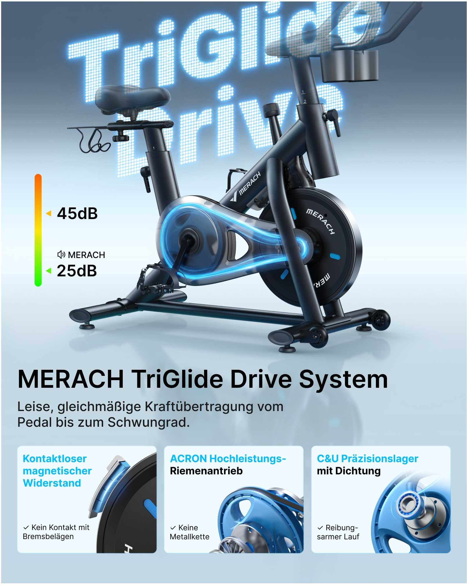
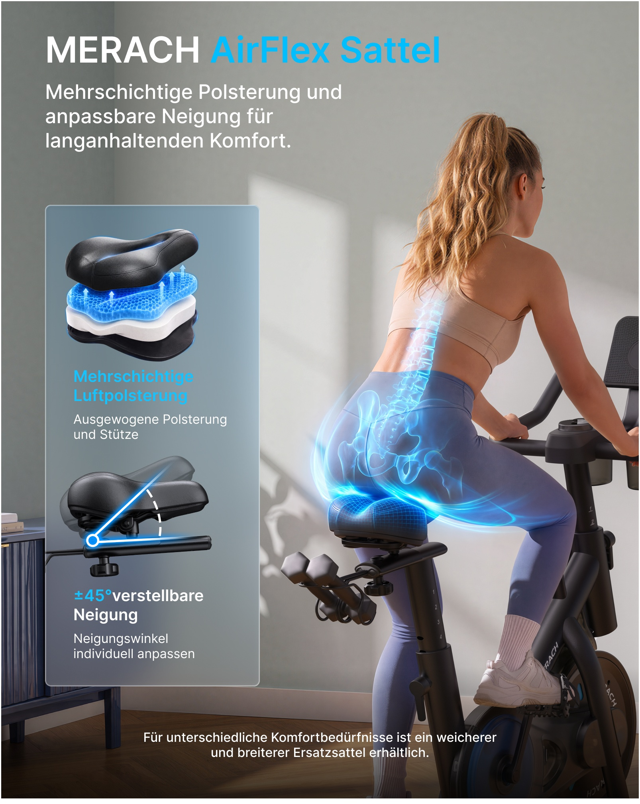
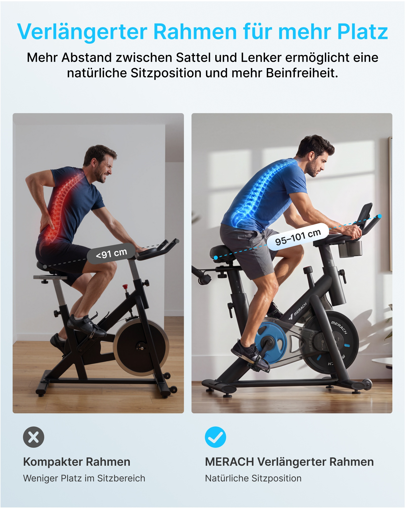
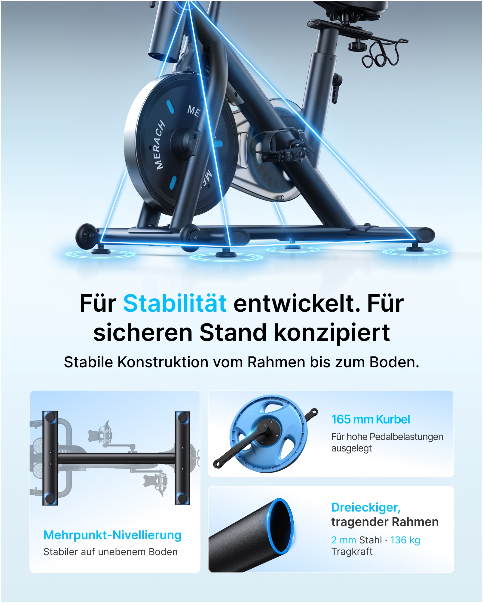
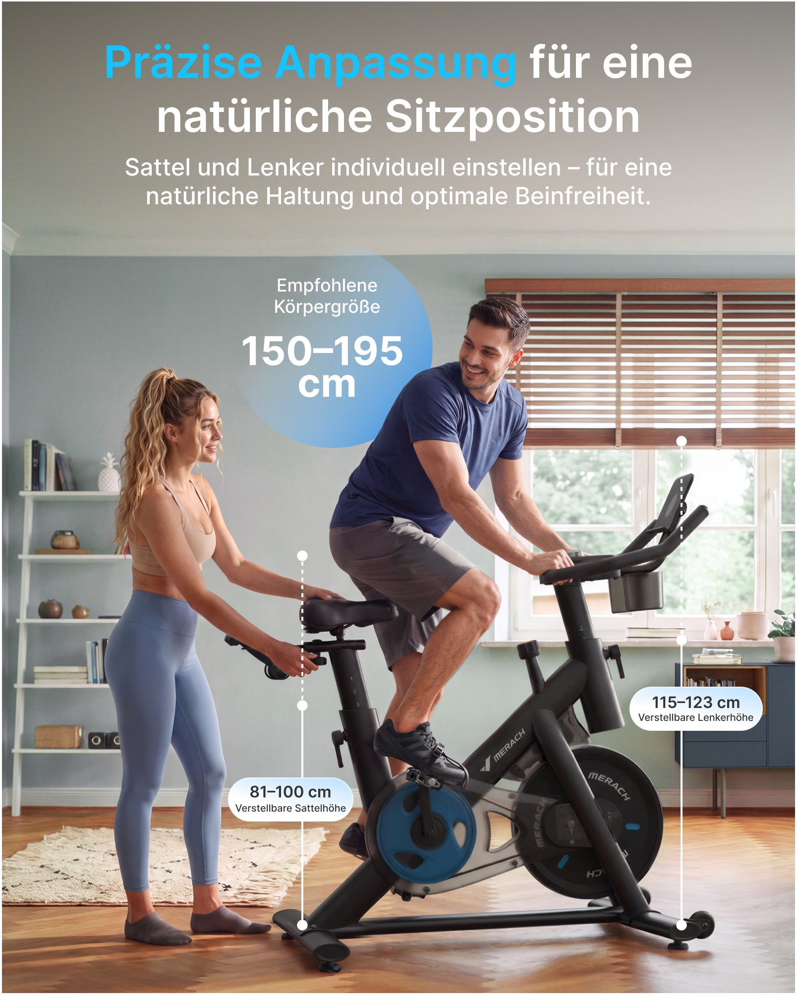

# PP-B01 · 动感单车.jpg

来源尺寸：9590 × 5177。5 个独立广告模块均逐张查看；顶部白底产品只浏览概览。

观察限定：字族未经识别，字号与版面比例为目视关系；广告参数及功效未核验。每条方法使用时须重新绑定目标产品事实和用户固定文案。

[随包原始拼板](../../assets/cases/pp-20261021/originals/board-01.jpg)

| 案例 | 主题 | 卖点检索 |
|---|---|---|
| PP-B01-C01 | 传动路径发光与底部三张机械证据卡 | 顺畅传动、低噪声、磁阻、皮带传动、轴承 |
| PP-B01-C02 | 骑行接触区支撑光与坐垫结构、角度双示意 | 坐垫舒适、分层缓冲、倾角调节、接触支撑 |
| PP-B01-C03 | 同场景双栏距离与姿态对照 | 骑行空间、座把距离、人体适配、姿态舒展 |
| PP-B01-C04 | 三角承力线、四个落地点与结构证据卡 | 稳定、车架承重、多点调平、曲柄强度、钢管结构 |
| PP-B01-C05 | 双人调节动作与垂直尺寸标注 | 座高调节、把手高度调节、多人适配、家用共享 |

## PP-B01-C01 · 传动路径发光与底部三张机械证据卡

原图像素区域：[445, 2404, 2050, 4415]。查看深度：已查看整板概览，并按原图像素坐标裁出完整广告模块逐张查看；查看工具适配缩放，未对所有小字做逐像素辨认。

**文字排版**：浅蓝背景上的主标题位于产品下方，黑色粗无衬线，左对齐；说明字约为标题的 0.55 倍。卡片小标题用青蓝关键词加黑色补充，说明文字再小一档。上半部超大点阵发光英文作空间背景，部分被产品遮挡，不能替代可读主标题。具体字体无法由图像确认。

**图片布局**：上方约六成是三分之四角度单车，车把允许超出画面形成近距离感；左侧留窄条放噪声刻度。中下方依次为标题、两行解释、底部等宽三卡。三张卡按磁阻、皮带、轴承从左到右阅读，各保留部件裁切与短句。

**卖点表达与可见证据**：透明传动罩与连续环路引导眼睛从曲柄到飞轮；底部可见接触间隙、带轮及轴承拆分形态。低噪声主要由侧边 dB 数字和色阶广告声称，静态画面本身无法证明噪声、轴承品牌或性能。

**光效与标注**：青蓝光带沿传动罩内皮带环路贴合，两端围绕两个轴心转弯，白亮窄芯加蓝色柔光；靠前车架仍遮挡后方路径。反射与淡阴影落在浅蓝地面。左侧由绿色过渡到橙色的竖条属于信息图，没有声音波纹。底部轴承局部白蓝光只强调边缘。

**可迁移提示词片段**：

> 将目标产品的已知传动部位安排在画面中心偏右，以三分之四角度保留外壳、踏板和车架形状。仅在已确认的传动路径叠加青蓝细光带，围绕真实轴心闭合，白色窄亮芯、低强度蓝色光晕，前方支架正确遮挡后方光带。左侧留出已核实噪声数据的独立标注区；无数据则取消刻度。下方用三张等宽浅底卡分别呈现用户提供的结构细节，每卡一个部件特写、一个关键词和一句固定文案；主标题与说明在独立浅底留白区左对齐。

**适用边界**：不得继承原品牌、系统命名、45/25 dB 或零部件品牌。 未知皮带路径或内部结构时改成外观细节卡，不凭空透视。 背景发光大字是装饰性空间层，关键文案应保持独立可读。

## PP-B01-C02 · 骑行接触区支撑光与坐垫结构、角度双示意

原图像素区域：[2188, 2398, 3794, 4415]。查看深度：已查看整板概览，并按原图像素坐标裁出完整广告模块逐张查看；查看工具适配缩放，未对所有小字做逐像素辨认。

**文字排版**：左上大标题白色品牌段加青蓝功能段，下一层三行白色说明；左侧透明蓝灰卡内青蓝粗标题、白色说明。标题、说明、卡片内文约 1:0.55:0.4。下沿独立小号白字放在变暗地板区。

**图片布局**：生活场景满版，骑行女性后侧身占右侧约六成，坐骨与坐垫接触处为中心。左下单个窄高半透明卡上下叠放分层坐垫与调节角度；主图不展示整台车，聚焦坐垫、骨盆及腰背。

**卖点表达与可见证据**：人物真实坐在坐垫上，坐垫分层图解释缓冲来源，角度图解释可调方法；主图人体骨骼线是广告信息覆盖，并不能证明医学改善。图上软垫层、空气结构和调节幅度均仅是参考图声称。

**光效与标注**：主图青蓝光在臀部与坐垫接触面最强，顺着骨盆外缘与大腿根部形成贴体弧线，腰椎有半透明骨骼轮廓；光效不扩散覆盖整个人脸。分层图蓝色蜂窝层从坐垫各层之间露出，数支小箭头竖直向上。角度图以真实连接轴为圆点，水平基准与斜向射线相交，虚线圆弧说明旋转；主体坐垫保持实黑。

**可迁移提示词片段**：

> 采用人物后侧方骑行构图，把臀部与真实坐垫的接触面置于视觉中心。若卖点为已确认的支撑或缓冲，在接触面添加薄层青蓝半透明受力示意，沿坐垫曲面衰减，不遮挡真实轮廓。左侧留窄高信息卡：上格只按用户提供的坐垫层次作分层展示，下格以真实调节轴为中心画基准线、倾斜线与虚线圆弧；角度使用已确认数值，没有结构图则使用外观特写。标题白色，功能关键词青蓝，所有固定文案逐字排入留白。

**适用边界**：骨骼透视不是临床证据，不移植脊柱矫正、治疗或康复保证。 不照搬原图的分层数量、蜂窝材质、倾角数值或可替换坐垫声称。 人物使用图与产品角度必须能形成正确的臀部、踏板、把手接触关系。

## PP-B01-C03 · 同场景双栏距离与姿态对照

原图像素区域：[3974, 2404, 5581, 4415]。查看深度：已查看整板概览，并按原图像素坐标裁出完整广告模块逐张查看；查看工具适配缩放，未对所有小字做逐像素辨认。

**文字排版**：浅蓝整底，上方青蓝粗主标题居中，黑色两行说明约主标题 0.6 倍。图内胶囊参数高对比大号数字，左栏深灰底白字，右栏白底黑字。图下勾叉图标、粗栏名、小解释顺次左对齐。

**图片布局**：中部为并排两张竖向圆角照片，右栏略宽。两边均侧看同一男性骑行和相近室内场景，构图保持地面与主体比例相近；左边手扶腰，右边双手自然握把。参数线沿座位至把手方向斜向穿过两图。

**卖点表达与可见证据**：身体动作、座把距离线和左右状态构成三重对照。左侧皱眉手扶腰，右侧前倾握把；红、蓝脊柱示意让两种状态可快速区分。但竞争产品尺寸、舒适结论与疼痛因果不是图片能证实的事实。

**光效与标注**：红色脊柱沿左人物背线由腰至肩，右人物同部位使用青蓝光；均贴合人体弯曲，不漂浮离体。尺寸线是有圆端点的虚线，连接座位后端至把手端附近；这是信息标注，不应成为穿过人体的强光束。

**可迁移提示词片段**：

> 用左右两栏解释用户已确认的两种适配状态，保持人物、机位、背景、产品比例一致，只改变需要比较的调节状态。每栏把座位与把手之间的实际距离用细虚线和圆端点标清，胶囊标签放在线段中央的衣服留白处。可用低饱和灰与品牌强调色区分状态，用人物真实坐姿显示空间差异；若没有可靠对照依据，改为同一产品两档调节示意，不编造竞品劣势或疼痛表现。

**适用边界**：不继承原参考的尺寸区间、竞品否定或身体疼痛因果。 不能为了对比扭曲人物脊柱、腿长和产品结构。 尺寸线应测量同类端点，不能一侧测外沿另一侧测内沿。

## PP-B01-C04 · 三角承力线、四个落地点与结构证据卡

原图像素区域：[5757, 2402, 7364, 4415]。查看深度：已查看整板概览，并按原图像素坐标裁出完整广告模块逐张查看；查看工具适配缩放，未对所有小字做逐像素辨认。

**文字排版**：主图下方两行黑色粗标题居中，只把稳定关键词改青蓝；说明黑色，约标题 0.55 倍。下方卡片标题青蓝、解释黑色，小于主标题。每卡图文方向一致，减少读取距离。

**图片布局**：顶部约 45% 展示低机位车架与前后支脚，产品上沿被原广告有意裁出。中段是中心标题。下部左侧大竖卡是底座俯视，右侧上下两张横卡分别为曲柄和管材截面；整体以浅蓝渐变统一。

**卖点表达与可见证据**：真实车架三角轮廓、四个脚垫位置、底座俯视和钢管断面让稳定卖点有具体对象。承重、钢管厚度、曲柄长度仍是原广告文案声称，不能凭光线或截面图确认。

**光效与标注**：细白亮芯的青蓝线从车架上部连接处向前后底座延伸，形成透视三角；部分后方线被飞轮和车架遮挡。四个脚垫各有与地面透视一致的扁椭圆双环，中心对准落地点。管口只在前缘环形边界加蓝光，强调厚度区域而不将整根管漂浮发亮。

**可迁移提示词片段**：

> 将目标产品的承重框架以低机位放大，保留前后支脚和真实落地点。沿已知受力框架叠加细青蓝三角示意线，节点锚定实际连接点，前景部件遮住后方线；每个可见脚垫下方只加一组贴地扁椭圆光环。下部用一个底座俯视大卡和两个结构细节小卡展示用户提供的调平部件、曲柄、管材，参数仅使用核实输入。主标题位于独立浅底区，稳定关键词单独着色。

**适用边界**：三角线是示意，不能当有限元分析或受力测试结果。 不得新增不存在的脚垫、加粗钢管或改变底座数量。 不迁移原承重、壁厚、曲柄长度数据。

## PP-B01-C05 · 双人调节动作与垂直尺寸标注

原图像素区域：[7537, 2398, 9147, 4415]。查看深度：已查看整板概览，并按原图像素坐标裁出完整广告模块逐张查看；查看工具适配缩放，未对所有小字做逐像素辨认。

**文字排版**：顶部居中两行白色粗标题，调节关键词青蓝，白色说明约标题 0.55 倍；背景墙为字区。左上中部半透明蓝圆内两行小标签配更大尺寸数字。两条尺寸标签均白色圆角胶囊，数字粗、功能小。

**图片布局**：满版明亮家居，男性在单车上，女性站左侧一手扶坐垫、一手接近调节旋钮，产品占画面中下部。座高尺寸线在车身左侧，把手尺寸线在右侧，使两种调节各有独立通道。

**卖点表达与可见证据**：手与调节部件接触说明怎么调；两条尺寸线的上下端点表达调节范围/高度；双人场景暗示不同身材使用。图片不能证实推荐身高区间或调整中的承载安全性。

**光效与标注**：无独立发光特效。暖窗光形成地板与人体自然明暗。尺寸线为白色细实线与短段虚线组合，端点白圆，标签放在各线中下部；圆形蓝渐变只作信息底板。

**可迁移提示词片段**：

> 用明亮家居中的实际调节动作表现适配：人物的手放在目标产品真实调节旋钮与支撑点，另一名使用者只在符合产品操作方式的状态下入画。座位和把手两侧各预留独立尺寸线通道，细白线、圆端点、白色圆角标签，尺寸与范围只使用用户给出的核实数据；没有数据时标签改为固定功能文案。顶部利用平整墙面留白排两行标题，功能关键词用品牌强调色，避免字压在人脸与把手上。

**适用边界**：不复制推荐身高、座高、把高范围。 动作必须符合目标产品说明，不能暗示负重时可安全调节。 两条线应分别锚定对应部件，不把虚线误绘为额外立柱。
