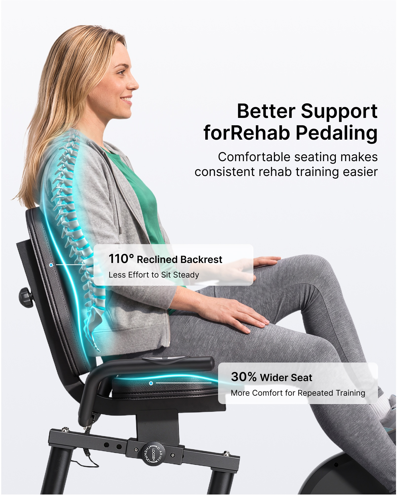
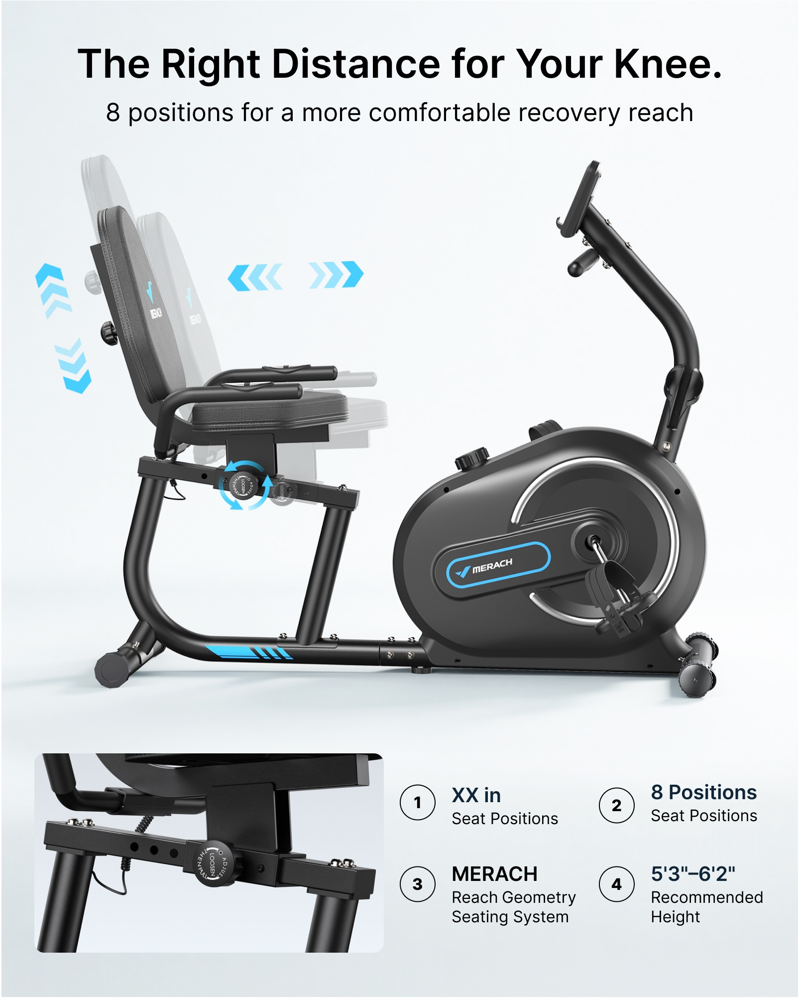
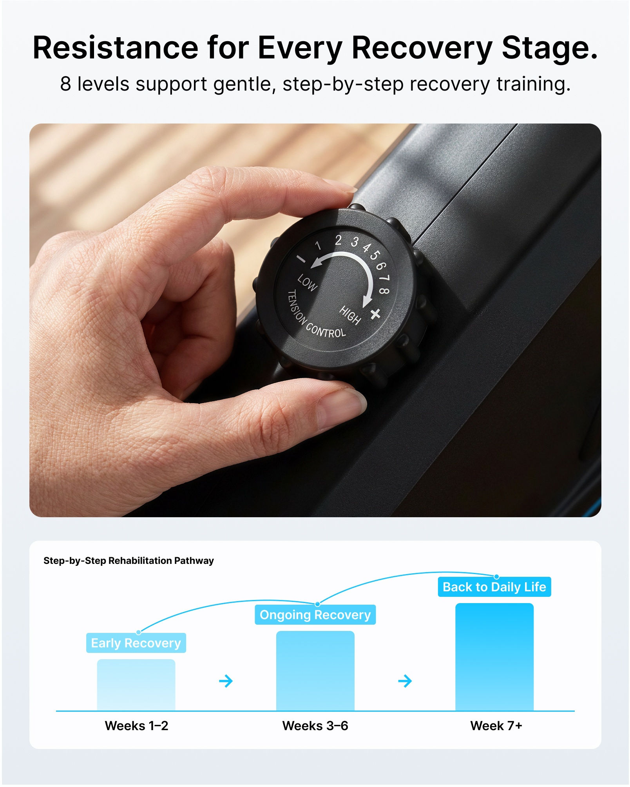
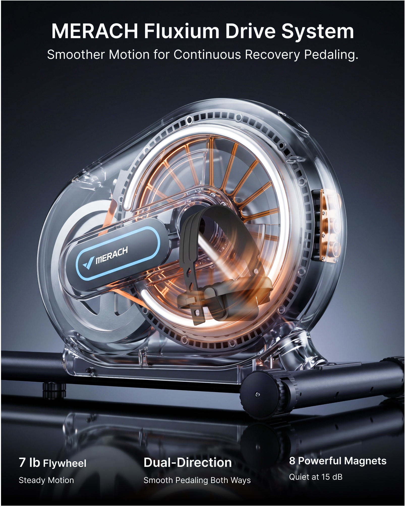
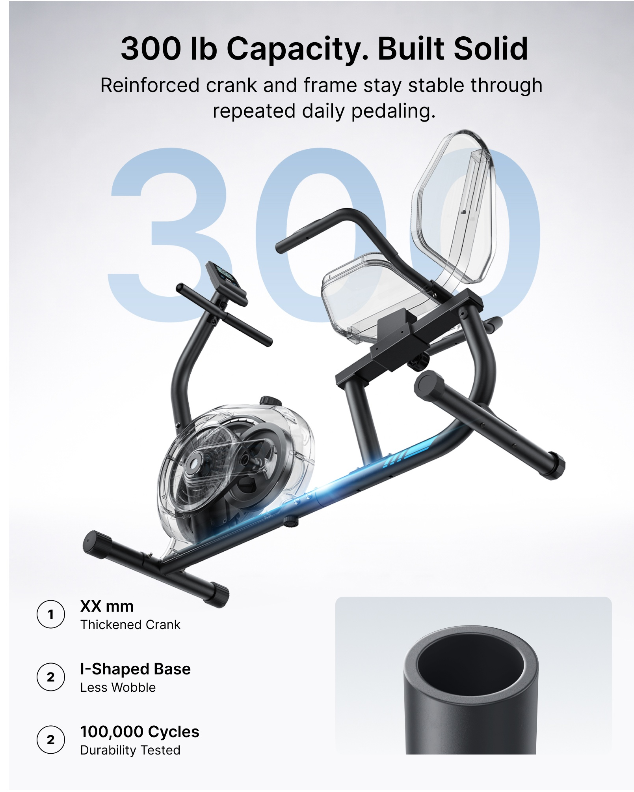
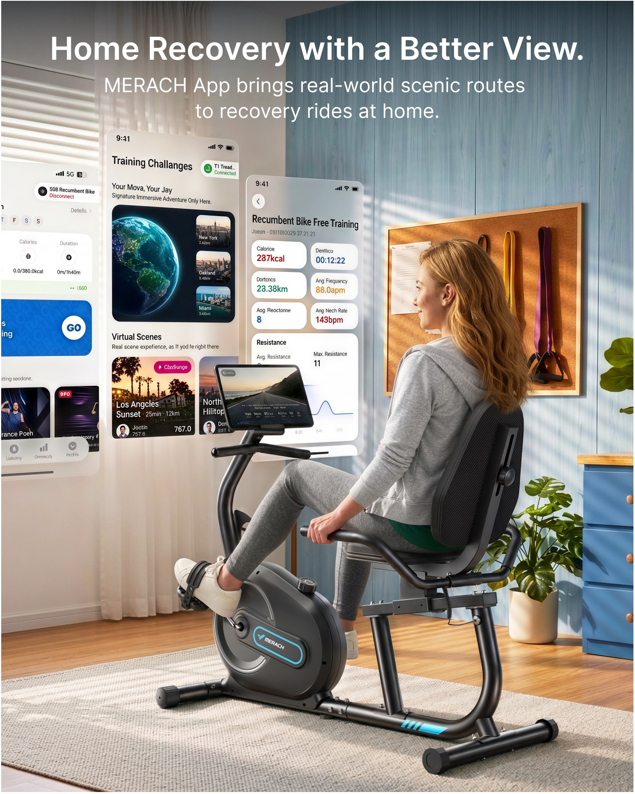
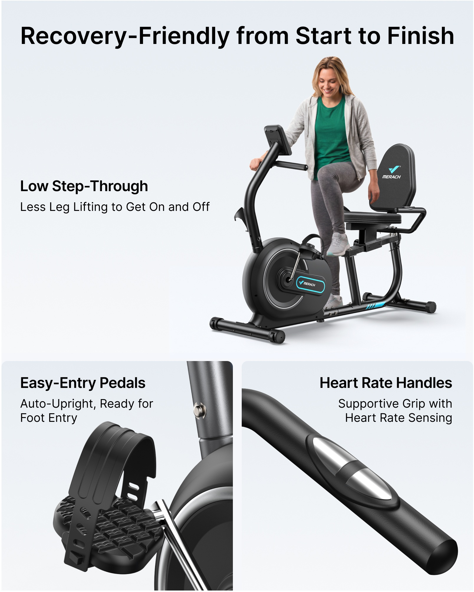

# PP-B02 · 椭圆机.jpg

来源尺寸：6854 × 6130。8 个独立广告模块均逐张查看；顶部白底产品只浏览概览。文件名与可见形态不一致，模块中为带靠背坐式健身车。

观察限定：字族未经识别，字号与版面比例为目视关系；广告参数及功效未核验。每条方法使用时须重新绑定目标产品事实和用户固定文案。

[随包原始拼板](../../assets/cases/pp-20261021/originals/board-02.jpg)

| 案例 | 主题 | 卖点检索 |
|---|---|---|
| PP-B02-C01 | 陪伴式骑行场景与底部三个收益图标 | 易于持续使用、陪伴指导、坐式骑行、日常活动 |
| PP-B02-C02 | 靠背与坐垫两处接触面高亮加短引线 | 靠背支撑、座垫宽度、坐姿舒适、接触面 |
| PP-B02-C03 | 调节残影、方向箭头与旋钮细节 | 座位调节、距离适配、调节档位、操作位置 |
| PP-B02-C04 | 旋钮操作大特写与渐进阶段图 | 阻力调节、手动操作、分级训练、循序调节 |
| PP-B02-C05 | 深色背景透壳机构与环形旋转轨迹 | 传动顺滑、飞轮、双向踏行、磁阻机构 |
| PP-B02-C06 | 弱化外壳突出承重骨架与管口截面 | 承重、稳固车架、底座结构、材料厚度、耐用 |
| PP-B02-C07 | 室内骑行与悬浮 APP 功能界面 | APP 联动、虚拟路线、训练数据、居家使用 |
| PP-B02-C08 | 上下车动作与踏板、扶手双局部 | 低跨步、便于上下车、踏板入口、扶手接触、心率感应 |

## PP-B02-C01 · 陪伴式骑行场景与底部三个收益图标

原图像素区域：[85, 1918, 1691, 3925]。查看深度：已查看整板概览，并按原图像素坐标裁出完整广告模块逐张查看；查看工具适配缩放，未对所有小字做逐像素辨认。

**文字排版**：顶部平整浅墙留白上放黑色粗无衬线单行标题，黑色副标题约 0.6 倍；底部三个白色线性图标与两行白字等距横排，底部地毯略暗保证对比。具体字体名不可确定。

**图片布局**：生活场景满版，女性坐式骑行居中，男性在右前侧蹲下，手靠近女性膝部和扶手，目光形成互动。车的前部位于左下，后部在右下，完整底座可见。背景公告板、弹力带、绿植补充场景但不占阅读主位。

**卖点表达与可见证据**：脚在踏板、背部与靠背相接，旁人蹲下协助的手部动作使使用场景易懂。关节活动、肌力及日常活动属于底部广告利益声明，不能凭场景证明康复效果；人物服装也不能证明专业资格。

**光效与标注**：没有专门信息光效。左侧窗光在墙、人物和地毯上形成斜向条纹，给皮肤和黑色机身柔和高光。底部线性图标为平面标识，无发光轮廓或能量轨迹。

**可迁移提示词片段**：

> 以完整真实使用动作作为主证据：使用者背部自然贴靠，双脚落在正确踏板，协助者在侧前方以符合使用情境的动作示意。让自然窗光照亮手、膝和产品接触点，保持机身结构清晰。顶部平整墙面排黑色粗主标题与一行说明，下沿用三个同规格线性图标对应用户已确认的三个收益，背景稍压暗以容纳白字。无需添加光效。

**适用边界**：原文件名为椭圆机，但可见产品是带靠背的坐式健身车，不能按文件名推断结构。 不把陪伴者认定为医生，不新增医疗认证或康复保证。 图标收益必须来自本次真实输入。

## PP-B02-C02 · 靠背与坐垫两处接触面高亮加短引线

原图像素区域：[1752, 1918, 3361, 3925]。查看深度：已查看整板概览，并按原图像素坐标裁出完整广告模块逐张查看；查看工具适配缩放，未对所有小字做逐像素辨认。

**文字排版**：右上两行黑色粗标题、两行常规说明，标题约说明 1.5 倍。两个半透明白色圆角标签内第一行粗体数值加功能，第二行小字收益；标签和主标题的对齐各自独立，不挤成一段。

**图片布局**：侧面坐姿大幅特写占左侧与下方，脸朝右，背部、坐垫完整可见。右上是大块干净浅灰留白；靠背标签在中部，坐垫标签在右下，均用短直引线回到对应接触面。

**卖点表达与可见证据**：背部贴靠的形态与座垫表面尺度可见，两个标签分别解释靠背角度和座宽。脊柱覆盖层是示意，靠背角度、百分比增宽及舒适结论是原图广告声明，未做实测。

**光效与标注**：靠背沿身体接触边缘形成青色细轮廓，并在衣服侧后方叠加半透明脊柱示意；坐垫前缘有独立青色弧光，两处发光互不连接。引线端点用小蓝圆加白边，白色水平线连到标签；避免引线穿过脸。

**可迁移提示词片段**：

> 选人物与产品侧面近景，完整展示真实靠背、腰背接触关系和座垫前缘。分别在靠背接触边与座垫曲面边添加低强度青色轮廓光，不让两处光带连成不存在的结构。每处配一个半透明白色圆角标签，以短直线和小圆端点指向实际部位，标签第一行放已确认参数或功能，第二行保留固定收益文案。右上留白排主标题。人体骨骼覆盖仅在确有需要且明确为示意时使用。

**适用边界**：不继承靠背角度、增宽百分比及医疗效果。 图中的骨骼线不能作为医学测量或人体内部真实影像。 标签应避免遮住手部和接触区域。

## PP-B02-C03 · 调节残影、方向箭头与旋钮细节

原图像素区域：[3458, 1918, 5065, 3925]。查看深度：已查看整板概览，并按原图像素坐标裁出完整广告模块逐张查看；查看工具适配缩放，未对所有小字做逐像素辨认。

**文字排版**：浅灰白底上方黑色粗标题居中，副标题一行较小。下方右侧四项编号以二乘二网格排列，数字圈、粗功能、细说明层级清楚。底部左侧细节框无厚边，与主图保持同色底。

**图片布局**：主图为产品完整侧面，占约中间六成，椅背与座位后方和前方各叠透明残影。底部左半是滑轨和旋钮细节，右半为四项信息。机身、底座保持单一实体，残影只作用于可调组件。

**卖点表达与可见证据**：旋钮与带孔横梁提供调节位置的可见线索，透明座位表达多档状态。原图额外上下箭头不能证明目标产品一定可升降；底部出现 XX in 占位，不能把它当最终参数。

**光效与标注**：没有环境发光；青蓝水平多箭头放在座位前方留白，左右方向对称。背后还出现上下箭头，旋钮周围为蓝色环形箭头。透明残影保留部件轮廓并降低不透明度，不应覆盖主实体的结构细节。

**可迁移提示词片段**：

> 用目标产品真实侧视图展示已确认的调节方向，仅复制可移动组件形成两处低透明度位置残影，机架和底座保持唯一实体。在移动轴线附近放细的双向箭头，在实际旋钮周围放短圆弧箭头。下方用一个近景卡展示锁定孔、导轨或旋钮，旁边用整齐编号说明操作和适配功能。只画用户资料支持的移动方向，不添加未确认的上下调节或档位数。

**适用边界**：原图有 XX in 占位参数；新图必须消除未填占位。 半透明位姿不等于结构验证，所有方向先检查目标产品。 不移植身高区间、档位数、系统品牌名。

## PP-B02-C04 · 旋钮操作大特写与渐进阶段图

原图像素区域：[5160, 1918, 6768, 3925]。查看深度：已查看整板概览，并按原图像素坐标裁出完整广告模块逐张查看；查看工具适配缩放，未对所有小字做逐像素辨认。

**文字排版**：黑色粗标题居中，副标题约 0.6 倍；中部照片没有叠字。下方白色圆角卡内左上小标题，三段色块标签白字，底部阶段说明黑色粗字。阅读层级为标题、旋钮、阶段图。

**图片布局**：顶部标题区约一成，中部大圆角照片约一半以上，手握黑色旋钮位于照片中心。底部独立卡画从左到右变高的三个蓝色柱形，细线连接三个节点，阶段之间有小右箭头。

**卖点表达与可见证据**：手指捏旋钮、刻度与加减方向直接说明操作。下方递进柱图将分级调节转为阶段叙事，但没有量化纵轴，不是测试数据图；图中康复周数及恢复日常活动结果仅为广告示意，不能推广为用户训练计划。

**光效与标注**：无专门发光光效；暖色窗光柔和照亮手部和旋钮刻度。下方使用蓝色平面渐变，最左浅、最右深，节点连接弧线与小箭头强化左至右顺序。

**可迁移提示词片段**：

> 将手指操作目标旋钮的真实微距照片置于画面中部最大圆角区域，完整保留旋钮刻度和指示方向，避免文字压在手上。顶部排主标题和一句固定说明。若用户需要表现渐进训练，下方用三段从浅到深的品牌色块加右向箭头表达用户已确认的等级或模式，标签使用初阶、进阶等真实命名；不要用没有依据的治疗周数、量化恢复曲线或保证结果。

**适用边界**：不迁移阻力档数和康复时间表。 阶段图没有量化纵轴，不能伪装成实验曲线。 新产品无实体旋钮时应换成实际控制方式。

## PP-B02-C05 · 深色背景透壳机构与环形旋转轨迹

原图像素区域：[85, 4031, 1691, 6038]。查看深度：已查看整板概览，并按原图像素坐标裁出完整广告模块逐张查看；查看工具适配缩放，未对所有小字做逐像素辨认。

**文字排版**：深蓝黑背景上白色粗标题居中，白色副标题较小；底部三组白字各两行横排，上行为粗功能，下行为细解释。标题和底部文字避开最亮的机械中心。

**图片布局**：一张主视觉贯穿，近距离展示前部飞轮壳和踏板，圆形内部件居中偏右，下方底座与暗镜面反射建立落地感。内部铜色轮圈与冷白外缘形成视觉焦点，字区上下一致。

**卖点表达与可见证据**：透明外壳使轮圈、传动区域和磁体示意可见，踏板旋转重影暗示连续运动；静图不能证实静音、双向性能或部件数量，透明机构本身也需要工程资料支持。

**光效与标注**：外壳是透明玻璃般示意材质，边缘冷白轮廓高光；内部铜橙发光环沿飞轮圆周分布，踏板附近出现绕轴弧向运动模糊，弧线服从圆周而非向外喷射。黑色前方踏板仍遮挡后方亮环，地板倒影低亮度。

**可迁移提示词片段**：

> 在深蓝黑背景中放大目标产品的核心传动区域。仅在有内部结构资料时将外壳设为半透明技术示意，保留真实外轮廓与所有前后遮挡；以冷白边缘光勾勒外壳，以低饱和铜橙细环强调真实旋转部件。围绕实际轴心加入短弧形运动轨迹，前景踏板挡住后方光环。上下留出深色干净文字带，底部三列仅写用户已确认的核心功能。

**适用边界**：不得凭外观生成虚构磁体数量、轮圈或传动结构。 不移植飞轮重量、噪声值、专有系统名。 轨迹是运动示意，不证明双向驱动；外壳透明也不表示真实材质。

## PP-B02-C06 · 弱化外壳突出承重骨架与管口截面

原图像素区域：[1752, 4031, 3361, 6038]。查看深度：已查看整板概览，并按原图像素坐标裁出完整广告模块逐张查看；查看工具适配缩放，未对所有小字做逐像素辨认。

**文字排版**：顶部黑色粗标题居中，两行说明较小；后景一组超大浅蓝数字占中部宽度，低对比以免抢过黑色骨架。底部左侧编号粗功能加细说明，右侧独立管口图。原图存在重复编号，属于应修正的编辑问题。

**图片布局**：产品以由左下至右上的斜向视角悬置展示，外壳、座垫与靠背透明化，支撑钢架保持黑色。顶部数字做背景，底部两栏分别放结构说明和管材截面。没有生活人物干扰。

**卖点表达与可见证据**：视觉注意集中在纵向主梁和横向底脚；截面特写给管壁提供可观察对象。图中承重与耐久次数为文字声称，图像不构成测试证据；XX mm 仍是未完成占位。

**光效与标注**：一条青蓝柔光沿下方主承力梁延伸，轮廓贴合管子表面，不穿出骨架；其余透明部件用灰白高光而非发光。背景数字无光晕，管口以常规软光显示内外壁。

**可迁移提示词片段**：

> 以三分之四斜向视角展示目标产品的真实承重框架，将不影响理解的覆盖件降低不透明度，钢架保持实体深色，确保管件连接与底脚数量完全一致。在主承力梁表面加入克制的青蓝细高光；背景可放一个用户已确认的大号参数，颜色淡且被主体自然遮挡。下方一侧列两至三个结构依据，另一侧放用户提供的材料截面特写。所有编号连续，参数未知则改为功能词，不留 XX。

**适用边界**：不复制承重、材料厚度、耐久次数。 不得用透明化伪造内部构造或省略真实承重连接。 原图重复编号和 XX 占位仅记录问题，不作为模板继承。

## PP-B02-C07 · 室内骑行与悬浮 APP 功能界面

原图像素区域：[3458, 4031, 5065, 6038]。查看深度：已查看整板概览，并按原图像素坐标裁出完整广告模块逐张查看；查看工具适配缩放，未对所有小字做逐像素辨认。

**文字排版**：顶部白色粗标题居中，白色两行说明较小，背景顶部压暗维持对比。大界面自带多级标题、卡片、数据，但原图若干 UI 小字明显不可靠，不应作为文字排版依据复刻。

**图片布局**：人物后侧方坐在画面右下，完整车体占中下部；三张放大的竖屏界面悬浮在左上到中部，按前后层次错位，真实平板放在车把托架上，人物视线朝设备方向。界面不压住人物脸和握持手。

**卖点表达与可见证据**：平板显示路线画面，放大界面包含地图/目的地、训练功能与数据卡，建立产品、屏幕、使用者之间的关系。是否真正连接、是否具备相应路线或数据功能，必须由目标产品资料确认。

**光效与标注**：没有能量束或连接波纹。暖窗光穿过百叶在墙面与地面形成条纹；悬浮 UI 采用浅白卡片和柔边，轻微透视与遮挡表示层次，属于信息展示而非实体全息投影。

**可迁移提示词片段**：

> 在明亮居家环境中以人物背侧方展示真实使用，产品屏幕或托架中的设备清楚可见。将用户提供的真实 APP 截图放大成两至三张错位界面卡，悬浮于人物视线前方的空白区域，主功能页置前、辅助页置后；设备屏幕内容与最前界面主题一致。保留截图准确文字，不生成随机界面数据，不用强光连接产品。顶部留出平静深色墙面排固定标题。

**适用边界**：不继承原品牌、路线、账号、测量数据、兼容关系。 原图部分 UI 有伪文字/拼写异常；应使用真实截图或简化示意，不学习错误文字。 缺乏真实界面素材时仅用明确标示的功能示意，避免伪造产品界面。

## PP-B02-C08 · 上下车动作与踏板、扶手双局部

原图像素区域：[5160, 4031, 6768, 6038]。查看深度：已查看整板概览，并按原图像素坐标裁出完整广告模块逐张查看；查看工具适配缩放，未对所有小字做逐像素辨认。

**文字排版**：浅灰底顶部单行粗黑主标题；上方主图左侧留白放粗小标题和一行解释。下方两卡标题在各自上沿，一侧左对齐、一侧右对齐，文字位置避开产品最大面积，字号低于主标题。

**图片布局**：上部主图约六成，人物扶把并抬腿进入产品，整台机器偏右，左侧留大字区。下部二等分卡分别放踏板入口与带金属接触片的扶手特写，圆角浅灰背景统一。

**卖点表达与可见证据**：低跨步通过实际抬腿路径和底座高度表现；踏板卡显示脚套开口，扶手卡显示金属片。自动回正与心率测量仍需产品资料，静止部件外观不能证明这些功能。

**光效与标注**：无专门信息光效。产品软光渲染让黑色纹理、金属接触片与踏板凹凸可读；只保留地面淡阴影，不添骨骼光、箭头或光圈。

**可迁移提示词片段**：

> 用人物真实进入目标产品的动作占据上部主图，手握实际支撑把手，脚部通过产品允许的入口，保留完整底座和腿部动作；主图左侧留白写已确认的便利卖点。下方并排两个近景卡，分别展示对应入口结构与手部接触部件，卡内只写各自固定文案。通过真实动作、开口形状、表面纹理和软光说明功能，无需额外发光特效。

**适用边界**：动作要符合实际进入路径，不能为了低跨步卖点扭曲人体或缩小机架。 不把金属片外观自动解释为心率功能，不复制自动回正声称。 原文件产品类别以图像结构为准，勿泛化到所有椭圆机。
