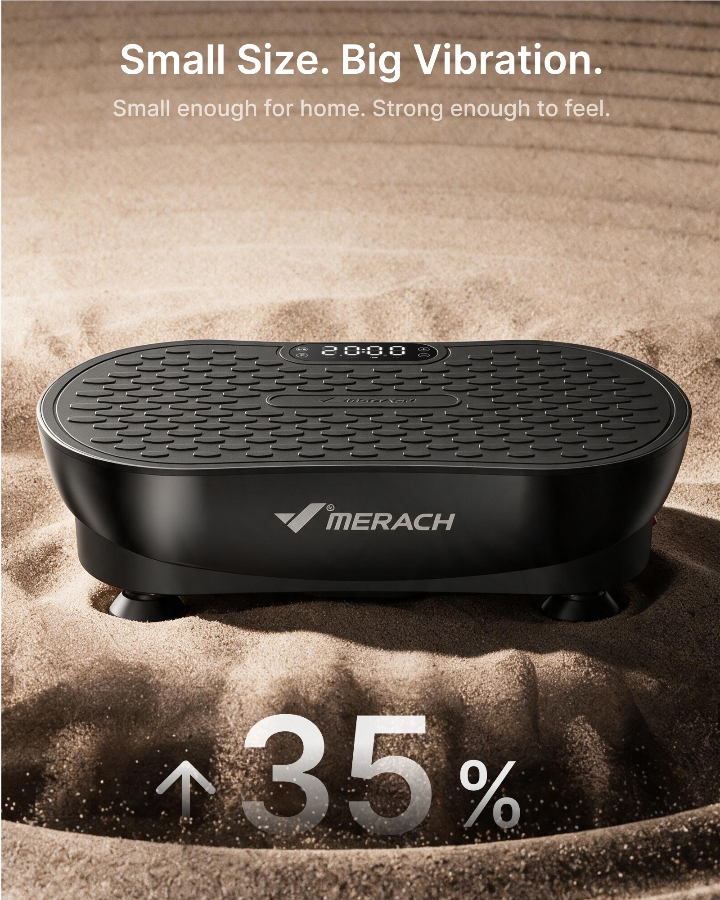
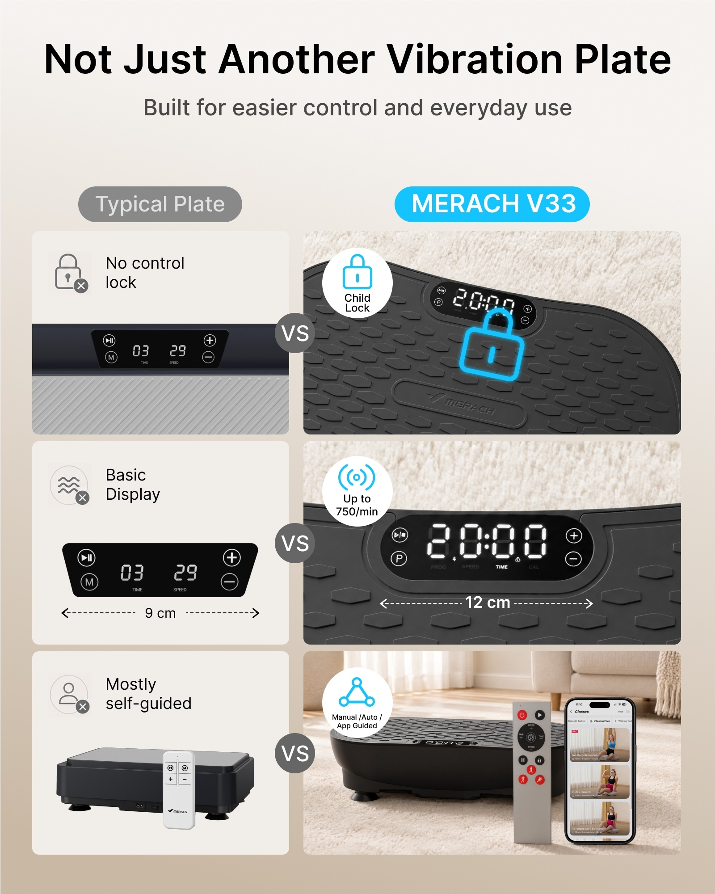
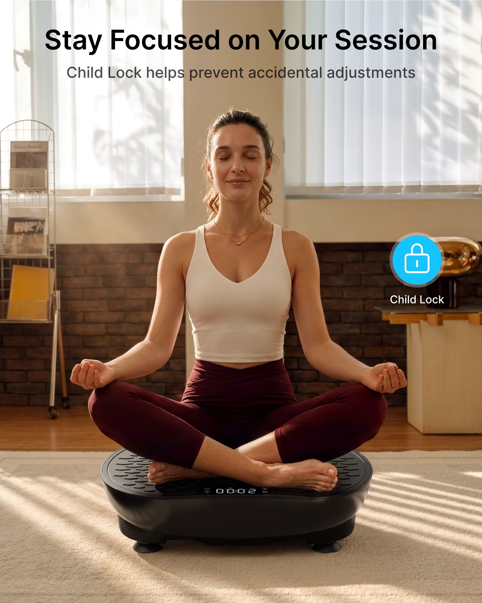
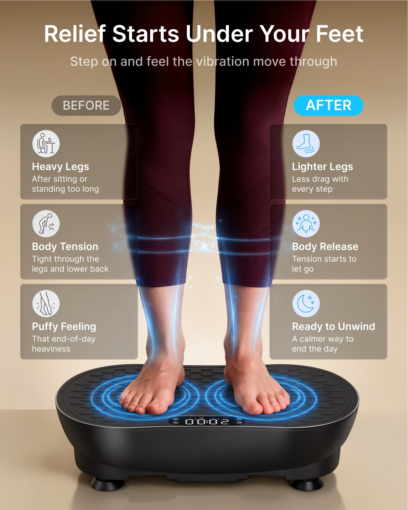
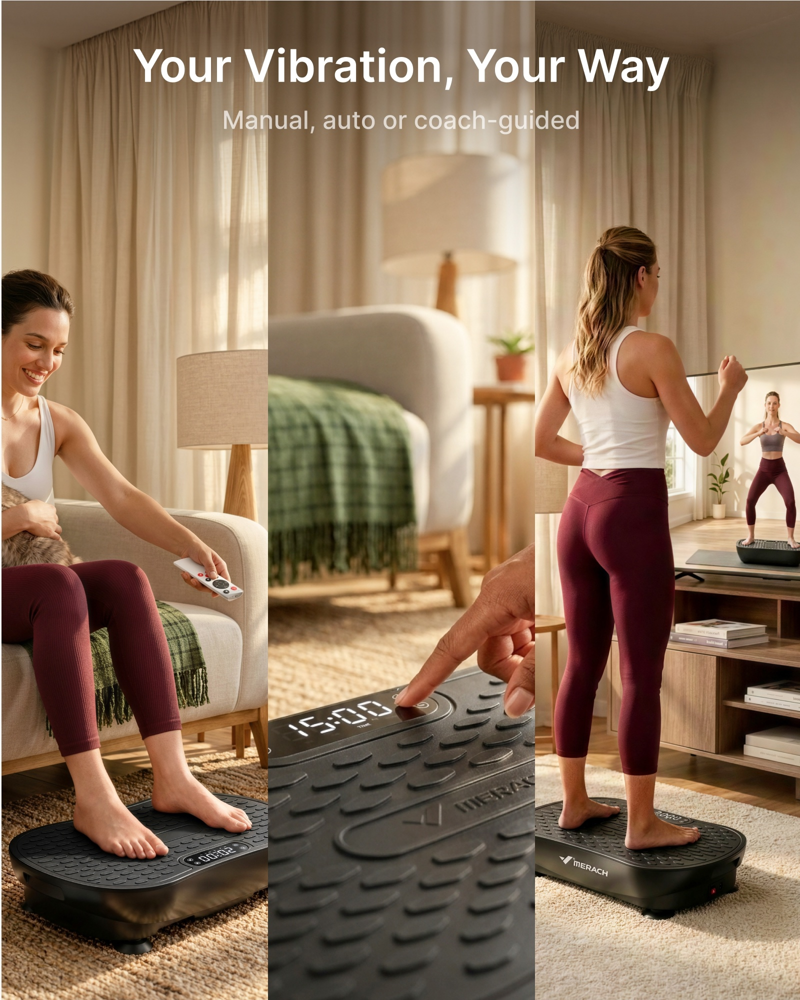
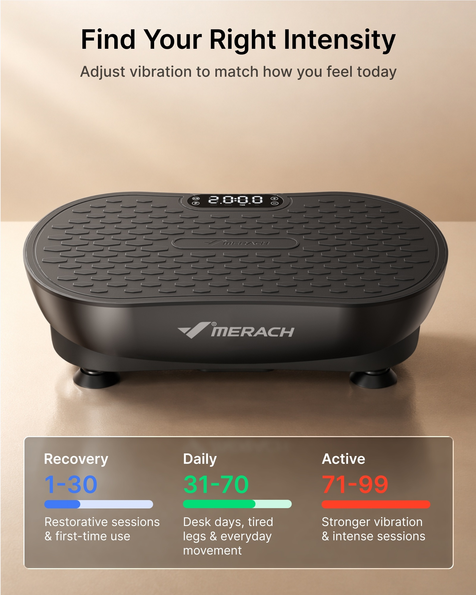
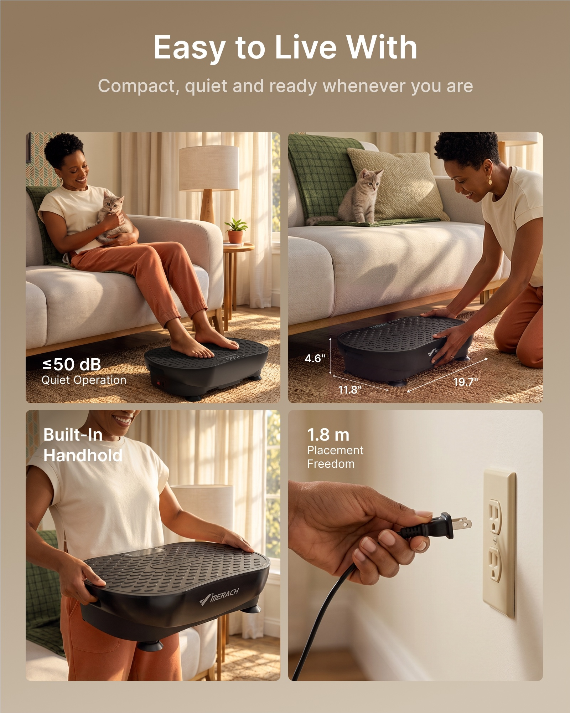
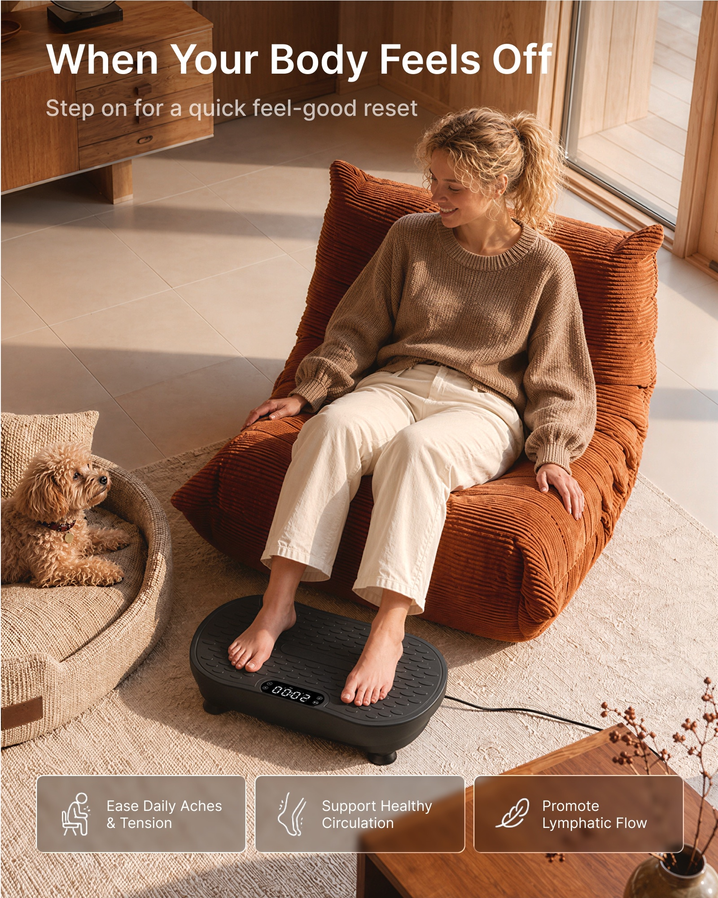
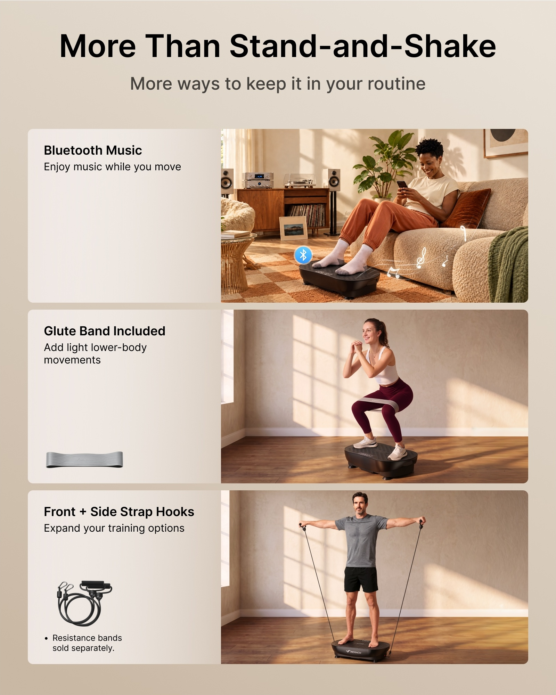
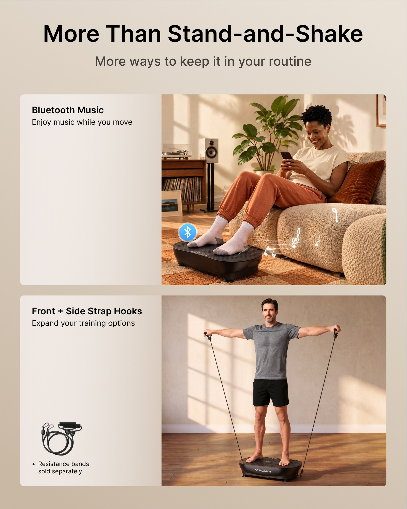

# PP-B03 · 甩脂机.jpg

来源尺寸：9822 × 6668。10 个独立广告模块均逐张放大查看，其中一例为三行与两行卡片的版式变体；顶部 4 张白底产品图只浏览概览。

观察限定：字族未经识别，字号与版面比例为目视关系；广告参数及功效未核验。每条方法使用时须重新绑定目标产品事实和用户固定文案。

[随包原始拼板](../../assets/cases/pp-20261021/originals/board-03.jpg)

| 案例 | 主题 | 卖点检索 |
|---|---|---|
| PP-B03-C01 | 振动可视化：柔和沙粒涟漪与大产品 | 振动感、紧凑体积、性能强调 |
| PP-B03-C02 | 三行对比：同一属性左右对应并放大真实部件 | 控制锁、显示面积、多种控制方式、差异对比 |
| PP-B03-C03 | 控制锁收益：安静专注动作与单一功能徽章 | 控制锁、避免误触、专注使用 |
| PP-B03-C04 | 作用位置：脚底涟漪向小腿延伸与两侧状态卡 | 足部振动体验、放松感表达、使用前后主观感受 |
| PP-B03-C05 | 多种操作：同一视觉系列中的竖向三联画 | 遥控操作、面板操作、跟练课程、多使用方式 |
| PP-B03-C06 | 强度选择：三级颜色与递进条形图 | 强度分档、适用场景选择、易于设置 |
| PP-B03-C07 | 日常便利：四宫格把抽象卖点变成具体动作 | 安静使用、小巧收纳、方便提拿、电源线长度 |
| PP-B03-C08 | 日常坐姿：大场景动作与底部三张轻量标签 | 坐姿使用、融入日常、放松体验、脚部接触 |
| PP-B03-C09 | 功能与配件：三行文字实物到使用动作的对应布局 | 音乐播放、配件包含关系、弹力带使用、拉绳挂点 |
| PP-B03-C10 | 同主题两行变体：减少卖点数量换取动作可读性 | 音乐播放、拉绳挂点、多功能训练 |

## PP-B03-C01 · 振动可视化：柔和沙粒涟漪与大产品

原图像素区域：[630, 2030, 2230, 4030]。查看深度：整板总览已看；单模块放大查看，颗粒波纹、文字层级与数字可辨，数字比较依据未在图中提供。

**文字排版**：暖褐背景上白色粗体标题居中，副标题约一半字高且更细；底部超大数字配上箭头和较小百分号，数字透明度略低，允许沙粒肌理透出。

**图片布局**：产品正面略俯视，横向占幅近九成并位于画面中段；顶部充分留白，底部沙纹近景承载大数字。产品、沙纹与文字构成上中下三层。

**卖点表达与可见证据**：沙面围绕产品出现环形起伏和轻微扬起颗粒，将不可见振动转为物理介质的变化。紧凑体积主要由标题声称，没有日常物体尺度对照；底部百分比缺少可见比较对象和测试条件。

**光效与标注**：无蓝色能量光。暖侧光擦亮沙粒顶部，环槽内产生深阴影；沙纹中心靠近产品位置，前景环纹被透视压扁。少量悬浮颗粒局限在近地面范围，不遮显示屏和产品轮廓。

**可迁移提示词片段**：

> 在目标产品的使用机制确实适合这一比喻时，让产品置于简洁暖色背景中，以产品底部附近为中心组织低幅度环状细沙纹或颗粒波纹，纹理贴着地面向外扩散并服从透视；用侧光显出纹理明暗，产品保持清晰锐利。顶部留两层文字区；只有提供明确提升指标和比较条件时才加入底部大数字，并注明画面为效果示意。

**适用边界**：不复制原广告的百分比；沙粒变化是艺术示意，不能声称实测振幅或真实适用地面。若新产品无振动功能，不使用该因果效果。

## PP-B03-C02 · 三行对比：同一属性左右对应并放大真实部件

原图像素区域：[4110, 2030, 5710, 4030]。查看深度：整板总览已看；单模块放大查看，三行对比主题、图标和主数据可辨。

**文字排版**：顶部黑色粗体标题和较小灰色副标题居中；两列上方分别用灰色与青色胶囊标签标识。每行内少量短句配圆形小图标，中央灰色圆点写 VS，纵向位置一致。

**图片布局**：两列三行卡片网格，右列宽于左列；第一行比较锁定操作，第二行比较显示部件，第三行比较控制入口。圆角卡片、统一行高和整齐间距降低信息杂乱。

**卖点表达与可见证据**：每一行给出对应部位或使用入口的可见图：控制锁标志、显示屏宽度线、产品加遥控器和手机。左列普通产品与右列目标产品的功能差异属于广告比较，不能当成已核实竞品结论；第二行右侧还有频次徽章，与显示尺寸并非同一属性。

**光效与标注**：第一行右侧的青色发光锁图标叠在产品表面，外围淡光晕不遮按钮；其它青色主要是分类色与图标色。尺寸为横向细虚线双箭头，与显示屏宽度相对应。

**可迁移提示词片段**：

> 将用户已证实的两种方案按相同属性排成三行两列，每行只比较一个核心问题；列标题使用中性灰和品牌强调色，行中间放简洁对比符号。优先采用目标产品的真实部件特写、真实操作附件和明确尺寸线，让短句紧贴对应图像。功能图标放在留白区或轻叠在所属部位，不将无关参数塞进同一行。

**适用边界**：仅在用户提供可核实对照资料时制作竞品优劣；不能沿用原品牌、尺寸或缺失功能结论。参考图同一行混入不同属性是应避免的做法。

## PP-B03-C03 · 控制锁收益：安静专注动作与单一功能徽章

原图像素区域：[5850, 2030, 7450, 4030]。查看深度：整板总览已看；单模块放大查看，人物姿势、产品接触与功能标签可辨。

**文字排版**：顶部黑色粗体单行标题，紧接较小灰黑副标题解释具体功能；右侧锁徽章下方白色短标签，放在较深背景以保证可读。

**图片布局**：人物盘坐在产品上，身体中轴居中，机器位于下部并完整露出；双臂伸展构成稳定三角。右侧背景留出空隙放锁图标，避免图标挡住脸或手。

**卖点表达与可见证据**：闭眼、稳定坐姿和放松双手呈现专注使用的结果；锁图标和副标题将这种体验归因于控制锁。实际锁定机制与防误触效果没有在图片中演示，证据强度低于按钮特写或锁定界面。

**光效与标注**：窗光从后侧进入，人物发缘有细暖轮廓光，地毯上可见窗影。青色圆形锁徽章带浅灰外圈，没有从人物或产品发出的能量束；属于信息标识。

**可迁移提示词片段**：

> 在目标产品支持该使用姿势且已确认控制锁功能的前提下，用平静自然的使用场景表达专注体验，主体居中、产品完整可见。标题说明收益，副标题明确真实功能；在人物侧面留白区放一个清晰锁定徽章，保持徽章与手脸分离。若有锁定状态界面，增加小幅真实界面作为直接证据。

**适用边界**：不得因为有控制锁而宣称适合儿童使用或全面安全。参考盘坐姿势不自动适用于新产品，须依照该产品说明。自然光与人物表情不能证明功能有效。

## PP-B03-C04 · 作用位置：脚底涟漪向小腿延伸与两侧状态卡

原图像素区域：[7590, 2030, 9190, 4030]。查看深度：整板总览已看；单模块放大查看，足底光圈、小腿光带和左右三层卡片可辨。

**文字排版**：顶部白色粗体标题及较小白色副标题；左右 BEFORE 与 AFTER 胶囊分别为灰与青色。三行半透明卡片内，症状或感受词为中号粗体，解释为较小常规体，各卡图标靠左上对齐。

**图片布局**：只截取膝部以下到整台产品，双腿与产品居中；两侧三张信息卡对称排列，窄中间区域保留腿部；产品底部占画面约四分之一。

**卖点表达与可见证据**：每只脚与平台接触处各有同心圈，蓝色细线沿小腿向上，明确视觉起点是足底。两侧所谓前后变化只有文字与图标，没有同一对象前后实拍，不能作为健康或循环效果证据。

**光效与标注**：两组青蓝同心光圈以各脚掌为中心，贴在平台表面按透视压扁；脚掌遮住圈线中央，圈线不穿透脚。两条纤细光带沿小腿两侧向上，膝下附近有低亮横向环带；少量光点在中间淡出。画面没有内脏、血管或医学剖面。

**可迁移提示词片段**：

> 以目标产品真实接触部位为特效起点：在两处接触面分别添加少量贴合表面透视的细同心圈，中心被真实身体或产品遮挡；需要表现主观体感传递时，用低亮细线沿接触部位向相邻区域短距离延伸并逐渐淡出，明确为体感示意。两侧信息卡只写用户已确认且允许表达的体验说明，避免将示意光线画成医疗作用。

**适用边界**：原图放松、沉重感或浮肿等文案是广告主张，并非疗效证据；不得迁移为治疗、改善循环、淋巴或消肿功效。未证实前后效果时改用功能与使用感受分栏，不能伪造 Before/After。

## PP-B03-C05 · 多种操作：同一视觉系列中的竖向三联画

原图像素区域：[630, 4150, 2230, 6150]。查看深度：整板总览已看；单模块放大查看，遥控、手指触按、屏幕跟练三种动作可辨。

**文字排版**：白色主标题跨三栏居中，副标题以较小白字列出三种模式；没有为每栏添加冗长标签，靠操作动作区分。背景上部窗帘色调接近，统一支撑跨栏文字。

**图片布局**：三条等宽竖向画面：左为坐着手持遥控器、脚放设备；中为手指按面板的近景；右为人物站在设备上看屏幕跟练。景别从中景到近景再到全身背侧景，打破机械重复。

**卖点表达与可见证据**：手中遥控器、指尖触按面板、面对课程屏幕的动作分别给出操作入口，形式直接清楚。副标题的手动、自动和教练引导不完全等于三个图片入口，迁移时需把文字标签与实际模式核对。

**光效与标注**：无功能性光效。三栏都用同一暖色窗光、米色软装和相近人物服装；中间浅景深把手指与按钮突出。不得额外添加蓝光连线去假装无线连接。

**可迁移提示词片段**：

> 把目标产品已确认的三种使用或操作方式安排为等宽竖向三联画，使用同一人物、服装、室内色调和光照方向。第一栏展示完整使用动作，第二栏放大手与真实控制部件的接触，第三栏展示另一种真实操作场景。每栏明确一个入口或模式，顶部统一标题；若加入短标签，必须与所示动作一一对应。

**适用边界**：面板按钮不自动证明自动模式，外部电视不自动证明产品连接能力；课程、遥控及模式必须有目标产品资料。人物、手指和屏幕内容不可从旧广告直接移植。

## PP-B03-C06 · 强度选择：三级颜色与递进条形图

原图像素区域：[2370, 4150, 3970, 6150]。查看深度：整板总览已看；单模块放大查看，颜色、条长、档位区间与说明结构可辨。

**文字排版**：顶部黑色粗体标题加较小常规副标题；底部半透明深棕卡中，每列白色组名、较大彩色档位数字、横条和小号说明自上而下排列。三列字段基线一致。

**图片布局**：产品放在干净暖米色台面，正面略俯视并居中放大；底部宽卡片分成等宽三列。主图与卡片之间留有空隙，避免卡片遮挡产品细节。

**卖点表达与可见证据**：蓝、绿、橙红分别表示由低到高的强度组；条形填充由短到长，颜色和长度双重编码让等级变化容易理解。使用建议由小字表达，实际档位范围仍来自广告参数，不由颜色证明。

**光效与标注**：无发光特效。产品边缘为柔和摄影高光；卡片的细白边框与低透明棕底建立层次。彩色条是平面数据图，不画成从机器射出的能量。

**可迁移提示词片段**：

> 将目标产品放在简洁统一的台面中居中展示，下方设置一张留有足够内边距的半透明信息卡。按用户真实设置将强度或模式分为若干等宽列，每列依次排列名称、已确认范围、由短到长的条形示意和一句适用说明；统一颜色从低强度到高强度递进，保留数字与文字以避免只靠颜色区分。

**适用边界**：不复制该图具体档位区间；不可自创恢复或健康适用人群建议。条形比例是分类示意，除非有数值映射依据，否则不当作精确强度图。

## PP-B03-C07 · 日常便利：四宫格把抽象卖点变成具体动作

原图像素区域：[4110, 4150, 5710, 6150]。查看深度：整板总览已看；单模块放大查看，四宫格动作、尺寸线及主要文字可辨。

**文字排版**：顶部白色粗体主标题和较小白色副标题居中；卡片内标题或数字采用白色较大粗体，简短解释用更小常规字重。文字靠各自图像的边角留白，避免跨宫格。

**图片布局**：暖棕底上四张等大圆角图片，间距一致。左上人物抱猫坐着使用，右上人物将产品移近沙发下并附三轴尺寸；左下双手搬拿，右下手持插头靠近插座。每格有独立证据动作。

**卖点表达与可见证据**：空间尺寸、抓握方式和插头形态可以由画面直接观察；抱猫安静相处只是低噪声的生活隐喻，不能证明分贝。电源线画面只展示插头和线的一段，不能证明整条长度。

**光效与标注**：无功能光效，四格保持暖自然窗光与柔和阴影。尺寸用细白实线和双箭头沿产品宽、深、高三个方向贴合透视；场景线条与尺寸线清楚区分。

**可迁移提示词片段**：

> 将目标产品四个已确认的日常便利点组成整齐四宫格，统一场景色调、圆角和间距，每格只展示一个可理解的动作：真实使用、放入收纳位置、手握实际把手搬拿、连接实际电源接口。尺寸线贴合产品透视，只标已确认数据；文字置于各格背景留白，不遮手与接触点。无法由动作证明的性能参数应另有资料支持。

**适用边界**：宠物平静不能证明低噪声，局部电线不能证明长度；不得照搬原图分贝、尺寸或线长。无把手或不允许该搬运姿势时，不复制人物抓握动作。

## PP-B03-C08 · 日常坐姿：大场景动作与底部三张轻量标签

原图像素区域：[2370, 2030, 3970, 4030]。查看深度：整板总览后追加查看单模块，长边 1100 px；底部三标签、双脚接触和电源线可辨。

**文字排版**：顶部白色粗体主标题置于较暗的木家具和背景上，副标题较小、较浅；底部三张横向圆角卡片采用细白边、半透明棕底，左侧线描图标与右侧两行白色短句对齐。

**图片布局**：人物坐在橙棕色休闲椅中，腿部向下连接前景设备；斜俯视同时看见椅子、双脚、平台及电源线。宠物位于左下环境区，人物视线指向宠物，底部标签横向等宽排列。

**卖点表达与可见证据**：放松坐姿、双脚平放平台和自然互动让设备融入休息日常；鞋袜未遮接触部位，动作易理解。底部关于疼痛、循环和淋巴的文字是广告主张，画面没有测量、医疗或前后对照证据。

**光效与标注**：没有功能光效。暖窗光从右上方向照入，形成明确地面窗影并勾勒人物头发；半透明标签让地毯纹理可见，但文字有足够底色。

**可迁移提示词片段**：

> 在目标产品允许坐姿使用的前提下，采用斜俯视日常休息场景，完整表现座椅、双腿与产品接触位置，让人物自然做用户已指定的轻松活动。保留统一暖窗光与真实投影；底部排列三张轻量半透明标签，每张以一个简洁线描图标配一句已确认功能或主观体验说明，不用光效遮挡真实接触。

**适用边界**：原图的疼痛、循环和淋巴表述不作为目标产品功效依据；可迁移的是坐姿场景和标签布局。人物宠物安静互动也不能证明噪声性能或安全结论。

## PP-B03-C09 · 功能与配件：三行文字实物到使用动作的对应布局

原图像素区域：[5850, 4150, 7450, 6150]。查看深度：整板总览后追加查看单模块，长边 1100 px；三行动作、附件小图、音乐图形与另购说明可辨。

**文字排版**：顶部黑色粗体标题居中，较小灰黑副标题在下；每行左上是粗体功能名和两行以内常规说明，附件图放在左栏下部，是否另购以更小但可辨的文本说明。各行左边界和文字层级一致。

**图片布局**：三行等高圆角卡片，左栏约占四成、右栏约六成。上行坐姿听音乐，中行使用环状带做下蹲，下行将拉绳连接产品挂点做侧平举；每行附件小图与右侧实际使用相对应。

**卖点表达与可见证据**：功能标题、附件实物与动作图建立一一对应：环状带围绕大腿、长拉绳从产品侧下部延伸到手柄。蓝牙图标和音符为音乐功能的示意，画面本身不能验证音源来自产品。原图明确区分一项配件包含与另一项另购。

**光效与标注**：上行在产品附近放青色蓝牙圆标，少量白色音符沿一条淡曲线向右上漂浮；音符位于脚与沙发之间空白，不遮产品。其余两行无功能光效，侧窗光与动作轮廓承担表达。

**可迁移提示词片段**：

> 将用户确认的三项功能排为三行等高卡片，每行左侧放短标题、解释与相关配件实物小图，右侧展示该配件或功能的正确使用动作。连接件、脚、手和配件接点必须可见且对应真实结构；每项是否随附或另购按用户文案逐字说明。仅对已确认音乐功能使用少量白色音符与小型连接标志，置于留白处。

**适用边界**：不能把另购附件画成默认套装；音乐图标不能用于未确认扬声器或无线能力。动作姿势、负载、拉绳挂点均应以目标产品说明为准，不能凭图复制。

## PP-B03-C10 · 同主题两行变体：减少卖点数量换取动作可读性

原图像素区域：[7590, 4150, 9190, 6150]。查看深度：整板总览后追加查看单模块，长边 1100 px；两行结构及与三行版的内容、比例差别可辨。

**文字排版**：延续三行版相同黑色标题、灰黑副标题、左栏粗体功能名与常规说明；左栏留白增多，附件小图和另购小字集中在下方，未把删除的一项内容压成角落小字。

**图片布局**：由三行压缩为两行，每行画面高度明显增加；上行坐姿使用设备听音乐，下行全身拉绳训练。人物、设备和连接带在同样画布面积内更大，动作接触更容易辨认。

**卖点表达与可见证据**：与 V09 相比删除了环状带下蹲的一整行，并重新放大剩余两行，体现按目标卖点数量重排版式的做法。下行双手、拉绳、脚和设备形成完整连接链；这是一套视觉的布局变体，不是新功能的额外证据。

**光效与标注**：延续第一行青色蓝牙圆标和少量白色音符，随放大后的场景重置在脚边到沙发前的留白区；第二行无特效，真实拉绳线条清晰，不添加重复发光轨迹。

**可迁移提示词片段**：

> 当本张只需要表达两项卖点时，将同系列三行模板改为两行等高大模块，并真正放大人物、产品和关键接触关系，不保留空行或把第三项塞成小字。每行保持左侧短说明、右侧使用画面，相关附件小图与是否包含的说明仍留在所属行。重排后检查音符、标志和文字的相对位置，确保不覆盖手、脚和连接点。

**适用边界**：此例是 V09 的同系列密度变体，应关联检索，不能把它计作另一组独立功能证据。不能因删减文案而丢失另购条件或将另购配件暗示为标配。
