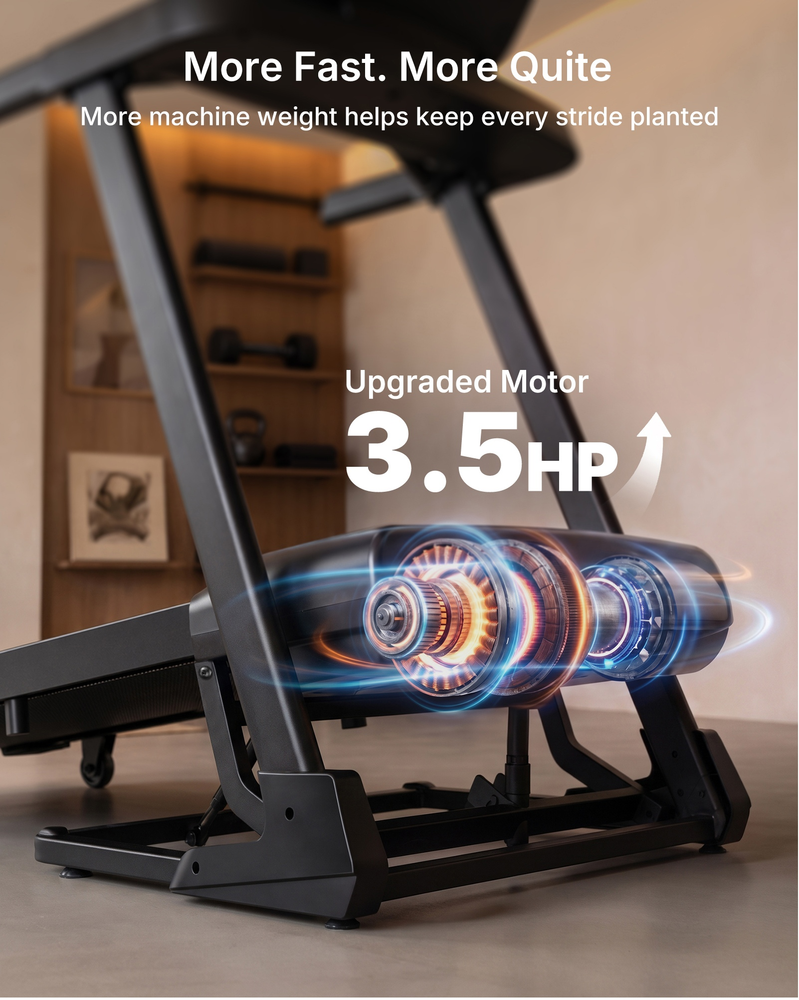
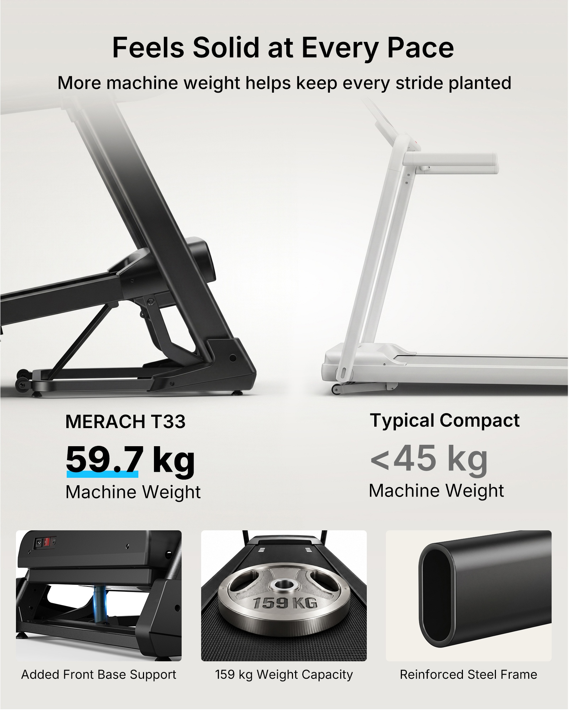
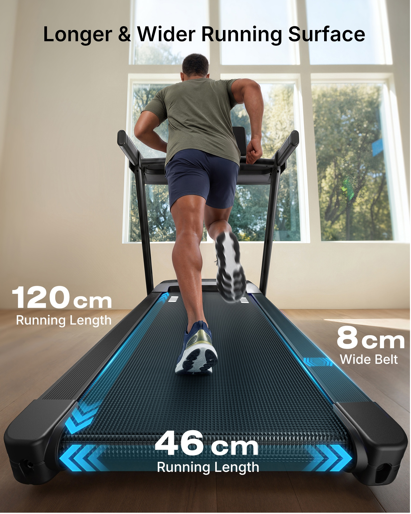
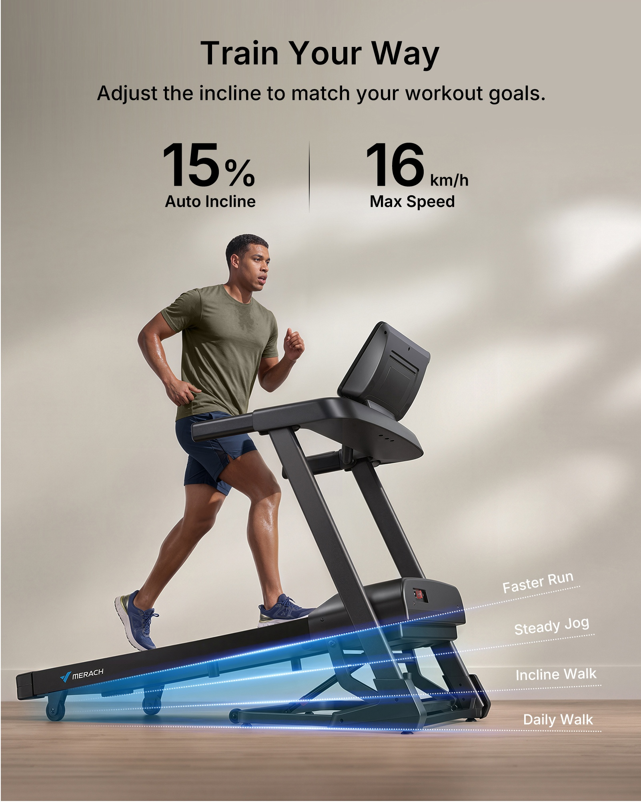
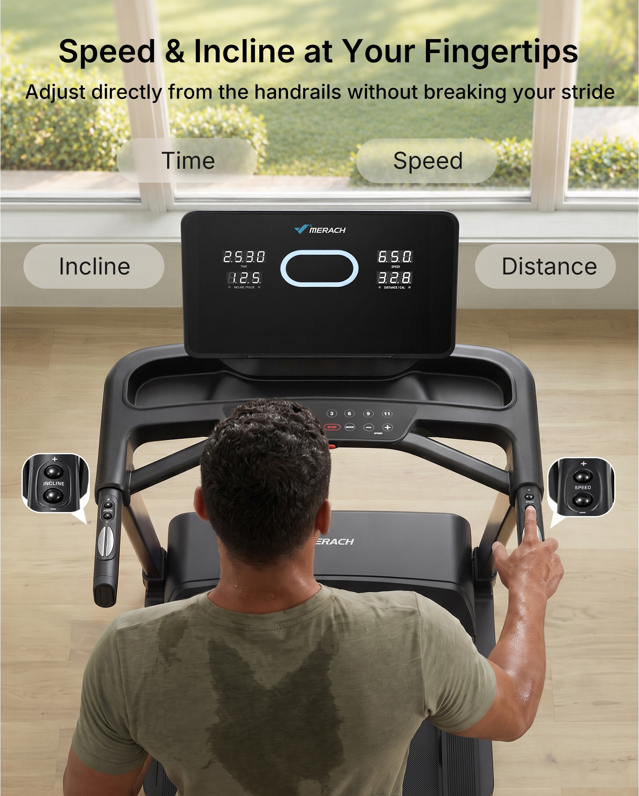
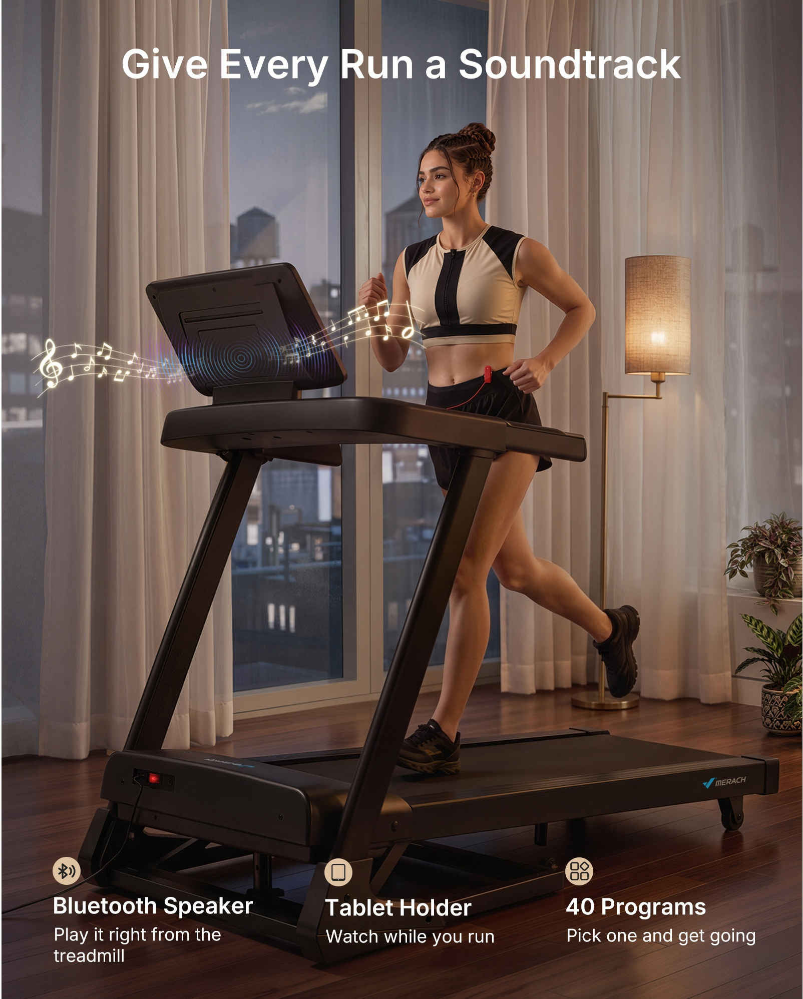
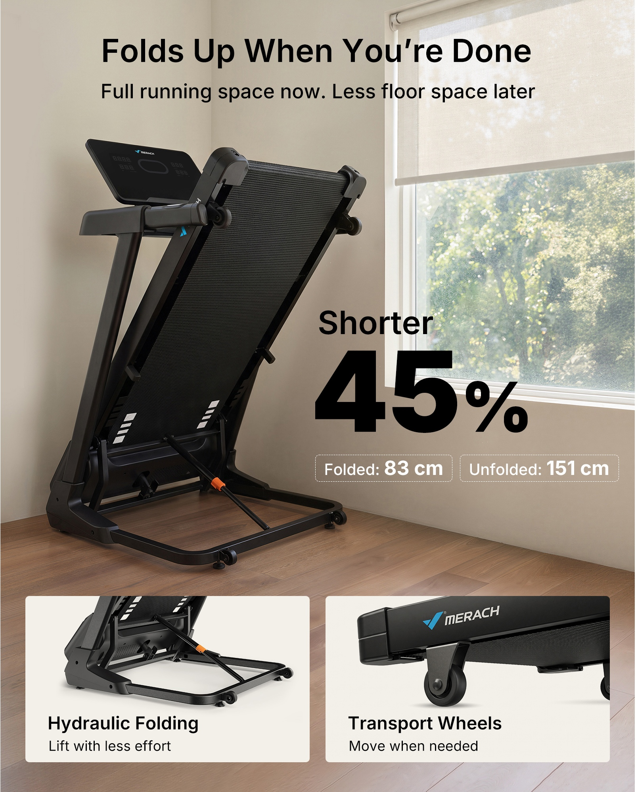
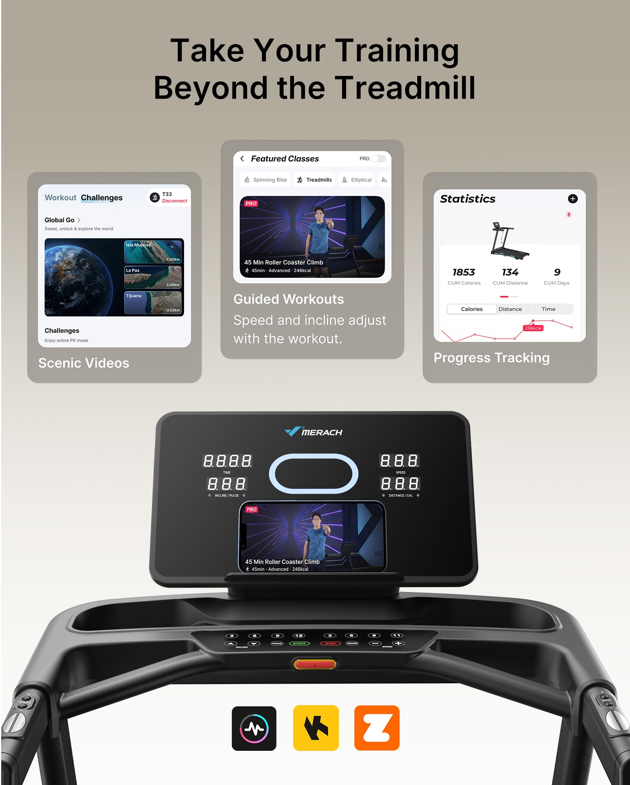

# PP-B04 · 跑步机.jpg

来源尺寸：6675 × 6281。下方 8 个独立广告模块均逐张放大查看；顶部白底产品主图只浏览概览。

观察限定：字族未经识别，字号与版面比例为目视关系；广告参数及功效未核验。每条方法使用时须重新绑定目标产品事实和用户固定文案。

[随包原始拼板](../../assets/cases/pp-20261021/originals/board-04.jpg)

| 案例 | 主题 | 卖点检索 |
|---|---|---|
| PP-B04-C01 | 真实家居中的马达透视与同轴光环 | 动力、电机、性能升级 |
| PP-B04-C02 | 同尺度结构对比加三张证据卡 | 稳定性、机架结构、承重、支撑 |
| PP-B04-C03 | 低机位纵深跑带与三向尺寸标记 | 运动空间、跑带宽度、跑带长度、侧踏板 |
| PP-B04-C04 | 坡度从实体抬升结构延伸到等级扇面 | 坡度调节、训练强度、速度 |
| PP-B04-C05 | 过肩操作视角与双按钮放大窗 | 扶手控制、操作便捷、信息显示、触手可及 |
| PP-B04-C06 | 暮色家居跑步与局部音乐波形 | 扬声器、听音乐、支架、运动陪伴 |
| PP-B04-C07 | 折叠后的体积收益与双部件卡 | 折叠收纳、节省占地、液压辅助、移动滚轮 |
| PP-B04-C08 | 三张应用功能卡与实屏内容对应 | 应用训练、课程引导、进度记录、场景视频 |

## PP-B04-C01 · 真实家居中的马达透视与同轴光环

原图像素区域：[0, 2227, 1602, 4230]。查看深度：overview_and_individual_module_crop_inspected。

**文字排版**：顶部居中白色粗体无衬线主标题，下一行较小常规字重说明；中部先小字功能名，后极大的数字与较小单位，形成标题—功能—核心数值三层。字体品牌无法确认。数字靠近马达上方，避免压住结构细节。

**图片布局**：暖灰室内作为整幅背景；低机位三分之二侧视的机架横跨下半部，两根立柱形成向上的斜线。马达局部是下半幅最亮焦点；上部虚化家具和墙面提供文字空间。

**卖点表达与可见证据**：可见线索是打开外壳式的圆柱机械组件、金属绕组和醒目功率字样；内部组件属于广告示意，照片本身不能证明功率或静音。上升弯箭头强化“升级”语义。

**光效与标注**：暖白窗光和室内反射维持产品体积；信息特效以马达横向轴心为锚点，橙色发光环贴着中部绕组，细蓝环沿两端圆形截面包围，蓝色轨迹沿壳体长轴延伸。局部发光叠加在透视壳内，机架前景维持实体遮挡，效果未扩散至全房间。

**可迁移提示词片段**：

> 保留产品参考图中的机架、外壳和真实尺寸比例，用低机位侧前方近景突出用户已确认的动力部件。仅当提供内部结构资料时，把该处外壳处理为局部半透明技术示意，内部沿真实转轴布置窄而半透明的蓝色环形轨迹，发光限定在部件内部；如无内部资料，改用外壳轮廓细光和真实部件特写。主标题居中放上方干净背景，核心参数只填写用户确认值，数字大于单位，紧邻该部件的空白处；其他支架、控制面板和固定文案保持可读。

**适用边界**：不能根据此广告推断目标产品内部绕组、转轴或马达位置。 原图数值、品牌和升级结论不能迁移。 原图主标题“More Fast. More Quite”用词有问题；副标题讲机重与步态，而主体讲马达，属于文案与证据错位，不应照抄。 橙色光在目标语境可能被读成发热或故障，需按卖点调整。

## PP-B04-C02 · 同尺度结构对比加三张证据卡

原图像素区域：[1674, 2227, 3278, 4230]。查看深度：overview_and_individual_module_crop_inspected。

**文字排版**：浅灰底黑色粗体无衬线标题居中，其下常规字重副标题。左右产品名同层对齐，关键数字放大、单位同行；左侧数字黑色并加蓝色短下划线，右侧数字降为灰色。底部三卡以图为主，下方一行小字解释。

**图片布局**：中部左右并置两种机架底部的侧视裁切，共用近似地面基线；左图深黑而完整，右图浅灰渐淡。底部三个等宽卡片依次展示前支撑、负重符号和管材截面，阅读从总论到比较再到部件。

**卖点表达与可见证据**：看得见的是前部底座支撑、管材截面及两款产品的几何差异；机重、承重和“更稳”由文字声称。负重圆盘上的数值是一种符号化表达，不能当作真实承重测试照片。

**光效与标注**：整体是高调柔光棚拍，地面保留接触阴影；只有左下细节卡中竖向支撑杆带窄蓝色强调光，沿杆身定位，不在整机外圈随意发光。蓝色下划线属于平面信息标记。

**可迁移提示词片段**：

> 若已提供可比产品与同口径数据，把两者以相同视角和尺度并排放置，底座落在同一地面基线，主产品保持真实颜色，对比项降低饱和度但保留结构可见性。标题说明一个明确收益；关键数据和单位在各自产品下方对齐。底部用三张等宽细节卡分别展示实际支撑、材料截面与有依据的测试或指标，每卡只解释一件事；细蓝光只贴在需要指出的支撑件上。没有可核验对比资料时，改为单产品的三证据卡，删除竞品结论。

**适用边界**：不能凭外观或机重证明动态稳定性。 不能继承对“Typical Compact”的重量及优劣结论。 管材截面需要真实资料；不能根据外壳猜壁厚。 不把示意负重盘变成测试认证或虚构实验。

## PP-B04-C03 · 低机位纵深跑带与三向尺寸标记

原图像素区域：[3375, 2227, 4979, 4230]。查看深度：overview_and_individual_module_crop_inspected。

**文字排版**：上方黑色粗标题位于明亮窗墙区；白色大数字与较小单位在跑带左侧、右侧和前端分布，每组下方附一行解释。底部横向数字最突出且压在较暗前沿上。

**图片布局**：相机贴近跑带后端向前看，跑带两条边向人物和控制台汇聚。人物背面居中跑动，一只鞋底抬起、另一只脚落在跑带中央，为步幅与剩余空间提供直观尺度；两侧保留室内地面给数字。

**卖点表达与可见证据**：长和宽通过透视跑带、落脚位置和沿边界的标记可理解；精确尺寸仅由文字给出。原图底部横向量被写成“Running Length”，与方向矛盾；右侧“Wide Belt”标签贴近侧踏板，指代也需澄清。

**光效与标注**：自然窗光照亮人物和地面；信息层为贴合跑带平面的青蓝细边线及半透明条带，纵向沿左右内边缘延伸，近端横向两侧是向外双箭头，另有短箭头跨越右侧踏板。光效服从近大远小透视，不在鞋面形成乱光。

**可迁移提示词片段**：

> 从产品后端低机位沿可用表面拍摄，保留真实宽长比例，让人物双脚和运动轨迹位于有效区域内。沿已确认的有效长度边界放一条细的透视尺寸线，沿近端有效宽度放横向双箭头，端点准确落在测量边界；若另需说明侧踏板，则用独立短线对应侧踏板并明确标签。长度与宽度分别放在相邻留白处，单位完整且只用已确认数据。蓝色线条贴合表面透视、亮度低于主体高光，绕开鞋和产品标识。

**适用边界**：原图横向尺寸的文字名称有错误，不可继承。 区分有效跑带宽、外侧踏板宽与整机宽，不能互相代用。 透视夸张会改变用户对空间的判断；不能拉宽目标产品。 人物仅作尺度线索，不证明尺寸或安全性能。

## PP-B04-C04 · 坡度从实体抬升结构延伸到等级扇面

原图像素区域：[5073, 2227, 6675, 4230]。查看深度：overview_and_individual_module_crop_inspected。

**文字排版**：顶部黑色大标题和较小居中副标题；其下两个数字组由细竖线隔开，数字大、单位小、功能名次级。底部右侧白色等级文字逐条贴合虚线角度，字号低于顶部参数。

**图片布局**：人物与整机居中偏下，采用能够看见底座、抬升支架和跑台斜面的侧面视角，背景为米灰墙与木地板。上半部留文字，右下方留给等级标签。

**卖点表达与可见证据**：跑台前端抬升和支架位置是可见线索；多条不同角度的点线把连续调节示意为不同训练强度。图中的速度与最大坡度是广告参数，人物跑步本身不能证明它们。

**光效与标注**：主光为柔和室内光；青蓝半透明光面限制在跑台下方与底座上方的楔形区域。数条细白点线由低位近似枢轴方向向右上散开，越高的线角度越大，并在右侧空白终止。原图部分光面覆盖支架，迁移时应保留其轮廓。

**可迁移提示词片段**：

> 采用产品真实侧视角，清楚展示跑台、底座和已确认的抬升机构。以实际旋转支点为中心绘制少量不同角度的细点线，向右侧留白延伸，每条末端只连接对应的已确认档位或状态。最低到最高角度之间填很淡的蓝色透明扇面，实体支架仍清楚可见，不能把整个机身染蓝。顶部用两组对齐信息呈现本图真正需要的参数，速度与坡度单位分开，标签只用用户提供的功能名称。

**适用边界**：百分比坡度不是角度数值，不能画成同数值角度刻度。 不得把手动档位画成自动连续调节。 日常走、坡走、慢跑、快跑与坡度关系属于示意，不能当作固定科学对应。 不可从原图继承速度、坡度上限或可调范围。

## PP-B04-C05 · 过肩操作视角与双按钮放大窗

原图像素区域：[0, 4285, 1602, 6281]。查看深度：overview_and_individual_module_crop_inspected。

**文字排版**：标题和说明居中置顶，黑字与窗外绿景背景形成对比；屏幕上方与两侧放浅色半透明胶囊标签，字号中等、横排单词。两个放大窗内保留原按键短字，不额外堆叠长文。

**图片布局**：人物后脑与肩背占下方，屏幕和左右扶手占中部，右手食指正触及右侧控制键。放大气泡分别位于左右扶手外侧的地面空区，尖角向内指向真实按钮。

**卖点表达与可见证据**：指尖接触按钮、真实按钮位置和可辨认的按键特写共同解释“手边可调”；四个信息标签指出显示项目，但原图未用引线逐一连接屏幕读数，不能仅凭标签推断映射正确。

**光效与标注**：白天窗光负责摄影氛围，无额外能量或速度光效。信息特效是圆角白框放大窗及浅米色半透明胶囊，重点在真实指向与对比度。

**可迁移提示词片段**：

> 以使用者背后略高的过肩角度拍摄，完整露出控制台和两侧实际按键。人物一只手自然操作本图要说明的真实按钮，食指与按钮明确接触且不遮住关键符号。把按钮特写放在相邻空白的白边圆角放大窗，短引线准确回到原按钮；左右功能不能串位。屏幕信息只保留输入图可确认的项目，标签和对应读数建立一对一关系。标题放顶部低纹理区，必要时加淡底提高可读性，不添加无关蓝光。

**适用边界**：需要目标产品按钮细节图才能写准操作功能。 不得用原图中的时间、速度、距离或坡度读数替代目标产品数据。 原图标签与读数缺少精确连线，后续应补清对应关系。 不能根据人物操作姿态声称安全性或不中断跑步的实际体验已验证。

## PP-B04-C06 · 暮色家居跑步与局部音乐波形

原图像素区域：[1674, 4285, 3278, 6281]。查看深度：overview_and_individual_module_crop_inspected。

**文字排版**：上方一行大号白色无衬线标题；底部三列各有米色圆形小图标、白色较粗功能名、较小的两行说明，左边界对齐。深色地板和机身为白字提供对比。

**图片布局**：竖幅夕暮客厅，人物位于右侧，设备屏幕后背在左中，整机延伸至底部。室内落地灯位于右侧，与窗外蓝灰暮色形成冷热对比；标题在上方窗帘区，三列功能沿底边排列。

**卖点表达与可见证据**：人物自然跑步建立使用情境；屏幕/支架实物可见，发声能力主要由标题、蓝牙图标和音符说明。程序数量由文字声称，图中并无相应界面证据。

**光效与标注**：摄影光是右侧暖灯和窗外偏冷的环境光。信息特效以屏幕后方附近为视觉声源，一组小型同心蓝圈加两侧柔和起伏的浅金五线谱与音符，范围限在胸部以下和屏幕附近；音符跨越部分画面但未遮挡脸。实际扬声器位置未由图片证实。

**可迁移提示词片段**：

> 将目标产品置于有真实生活陈设的傍晚室内，以暖色室内灯配合窗外偏冷余光。人物自然使用产品，姿态与产品接触关系准确。只有目标产品确认具备扬声器时，才从真实扬声器位置发出细而半透明的短声波或少量音符，曲线沿左右留白舒展，透明度逐渐降低，不穿过脸、不盖住屏幕内容。主标题放上方暗而均匀的区域；底部用等宽小功能栏承接已确认的相关卖点，图标、功能名、说明依次排列。

**适用边界**：不能默认屏幕背面就是扬声器位置。 蓝牙连接不自动等于可以播放音乐。 原图程序数量、品牌和人物不可照搬。 音符是说明声音存在的符号，不证明音质、音量或静音。

## PP-B04-C07 · 折叠后的体积收益与双部件卡

原图像素区域：[3375, 4285, 4979, 6281]。查看深度：overview_and_individual_module_crop_inspected。

**文字排版**：上方黑色粗标题与常规副标题居中。右侧收益词在超大百分比上方，数字成为第二视觉中心；下方两枚细虚线圆角框放折叠前后长度。底部两卡使用左对齐的粗功能名与较小解释。

**图片布局**：折叠整机占左半与中部，在靠窗墙角落地；右侧窗下墙面留给核心占地收益。下方两张横向细节卡分别展示液压杆及运输轮，卡图不与主图争同等面积。

**卖点表达与可见证据**：折起的跑台、支撑杆和滚轮是可见实物线索；缩短比例由前后长度标签支撑，但该百分比仅是原广告的特定测量口径，不能泛化为占地面积或体积减少。

**光效与标注**：窗光形成柔和亮面与地面接触阴影，无功能发光特效。细虚线框只框文字，不代表尺寸线；液压杆橙色部位是实物颜色而非流动光。

**可迁移提示词片段**：

> 用产品参考中真实的折叠状态作为主图，放在干净家居墙角，保留折叠支点、支撑杆和滚轮。把可计算且口径明确的收纳收益放在右侧留白：先写收益名称，再写用户确认的数值，下面并列对应的展开与折叠测量值并统一单位。没有完整数据时只写“折叠收纳”等已确认事实。底部两张卡分别给真实辅助折叠机构与移动轮特写，每卡配一个简短说明；自然窗光与接触阴影足够，不额外添加科技光。

**适用边界**：长度缩短百分比不等于占地面积或体积缩小百分比。 需要真实折叠图，不能自由发明关节或折叠姿态。 支撑杆外观不能证明液压功能，须用户确认。 不能继承原图任何尺寸、缩短比例或“省力”幅度。

## PP-B04-C08 · 三张应用功能卡与实屏内容对应

原图像素区域：[5073, 4285, 6675, 6281]。查看深度：overview_and_individual_module_crop_inspected。

**文字排版**：顶部黑色粗体两行标题居中。上半幅三张灰米色圆角卡中，截图在上、白色粗功能名在下；中间卡再加两行较小的白色说明。卡内文字左对齐；整机下方三枚应用图标等距排列，不与功能名称混排。

**图片布局**：三张功能卡横向排布，中间课程卡略高，左右为场景与统计；下半幅是正面控制台，手机固定在中央支架上，手机课程画面与上方中心卡呼应。产品扶手从左右底边收进画面，形成承托关系。

**卖点表达与可见证据**：截图、手机画面和简短功能名把应用功能从单纯图标变为可理解的使用内容；中心卡声称速度与坡度随训练调整，这属于具体联动能力，需要独立确认。界面中的统计数字只是案例截图中的显示。

**光效与标注**：无连接光束或蓝色能量特效。摄影部分为柔和棚拍亮边；功能卡使用不透明或低透明度的灰米底把白色说明从背景中隔开，圆角和细阴影建立层次。

**可迁移提示词片段**：

> 用目标产品真实控制台作下半幅主锚点，手机放在其真实支架上，显示用户提供的训练界面。上半幅最多三张等宽功能卡，截图在上、简短收益名称在下，中间核心功能卡略抬高；手机与中心卡使用同一课程或同一任务画面，建立清楚对应。每卡只写已确认的功能，尤其是速度或坡度自动联动必须有明确资料。下方仅放确认兼容的应用图标，保持控制键和屏幕可读，不增加虚构连接光。

**适用边界**：应用显示课程不等于具备控制跑步机速度与坡度的权限。 不继承截图中的运动统计、课程内容、品牌或兼容结论。 原图数码屏是全段显示样式，不能把这些八字形显示当实际运行读数。 小界面文字未逐字核验；目标提示词应使用原始截图而非重绘大量细字。
