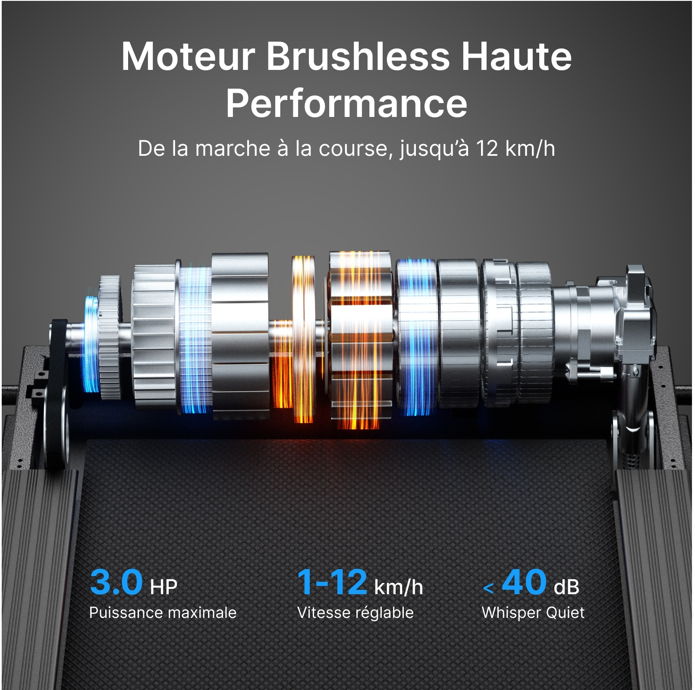
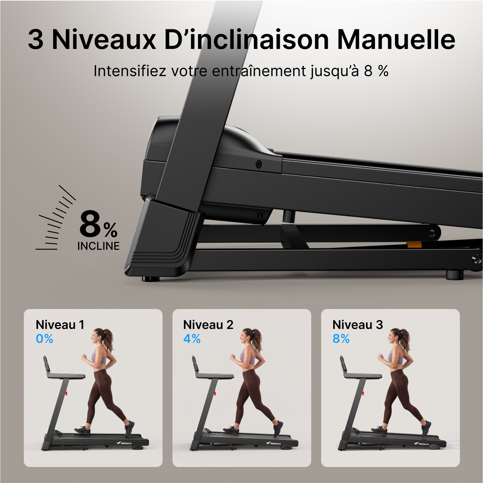
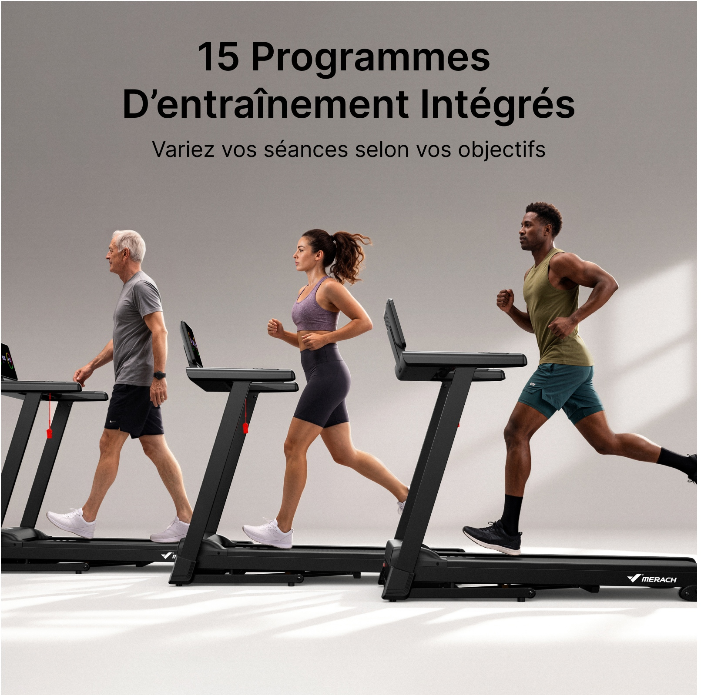
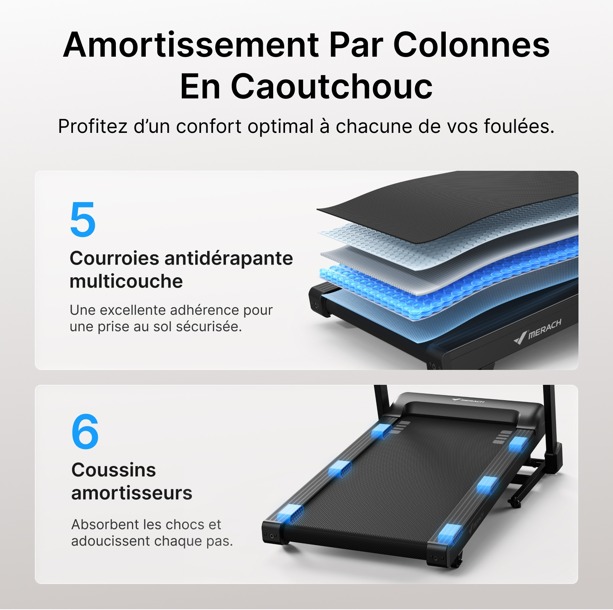
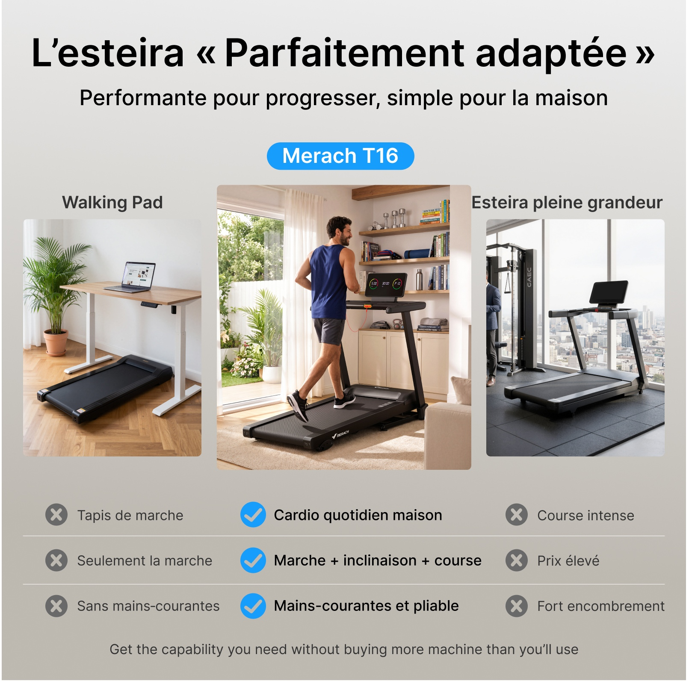
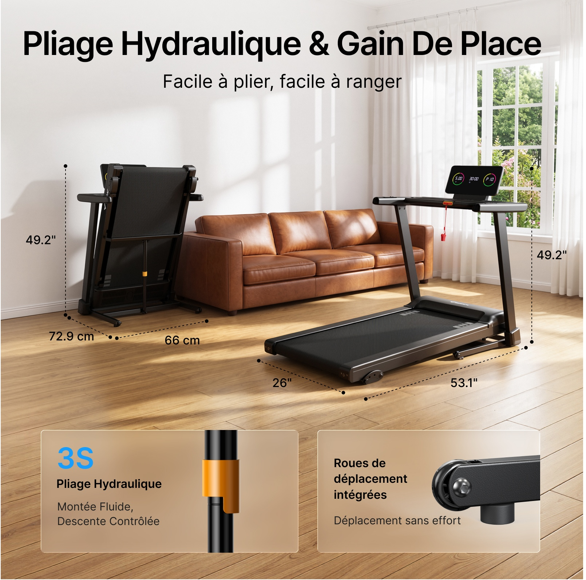
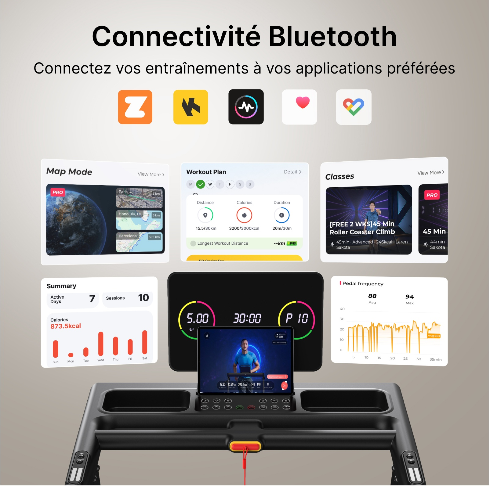
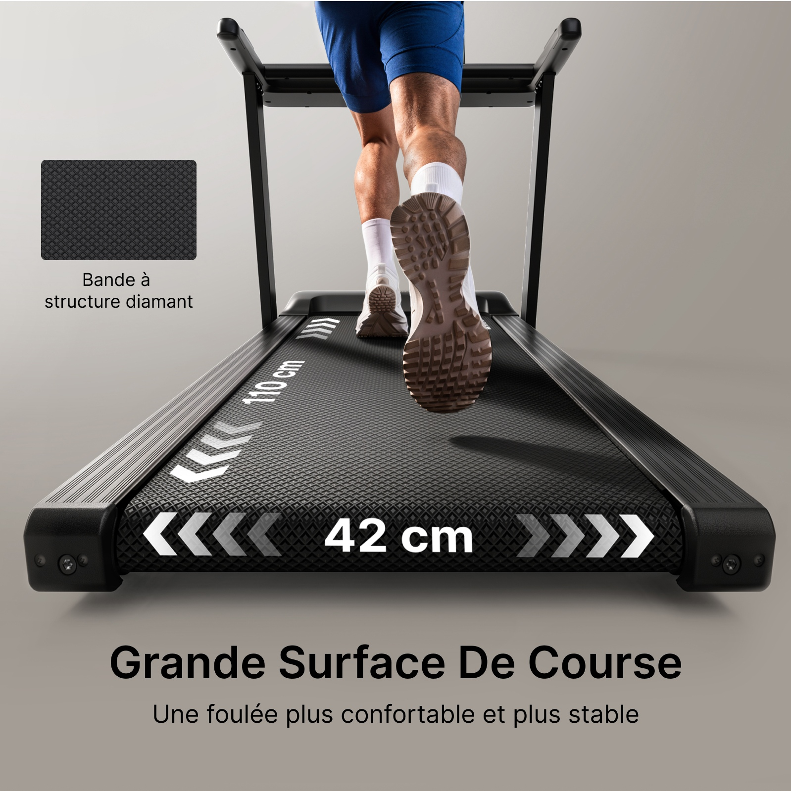
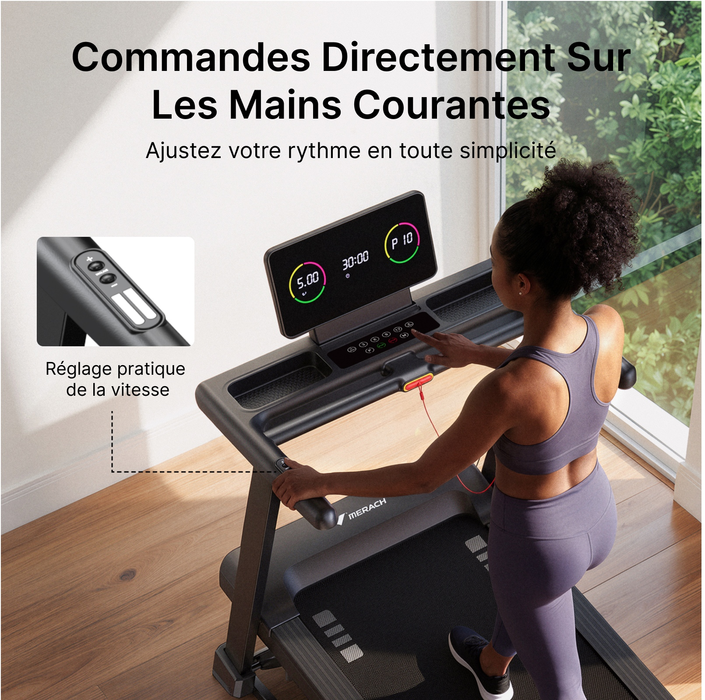
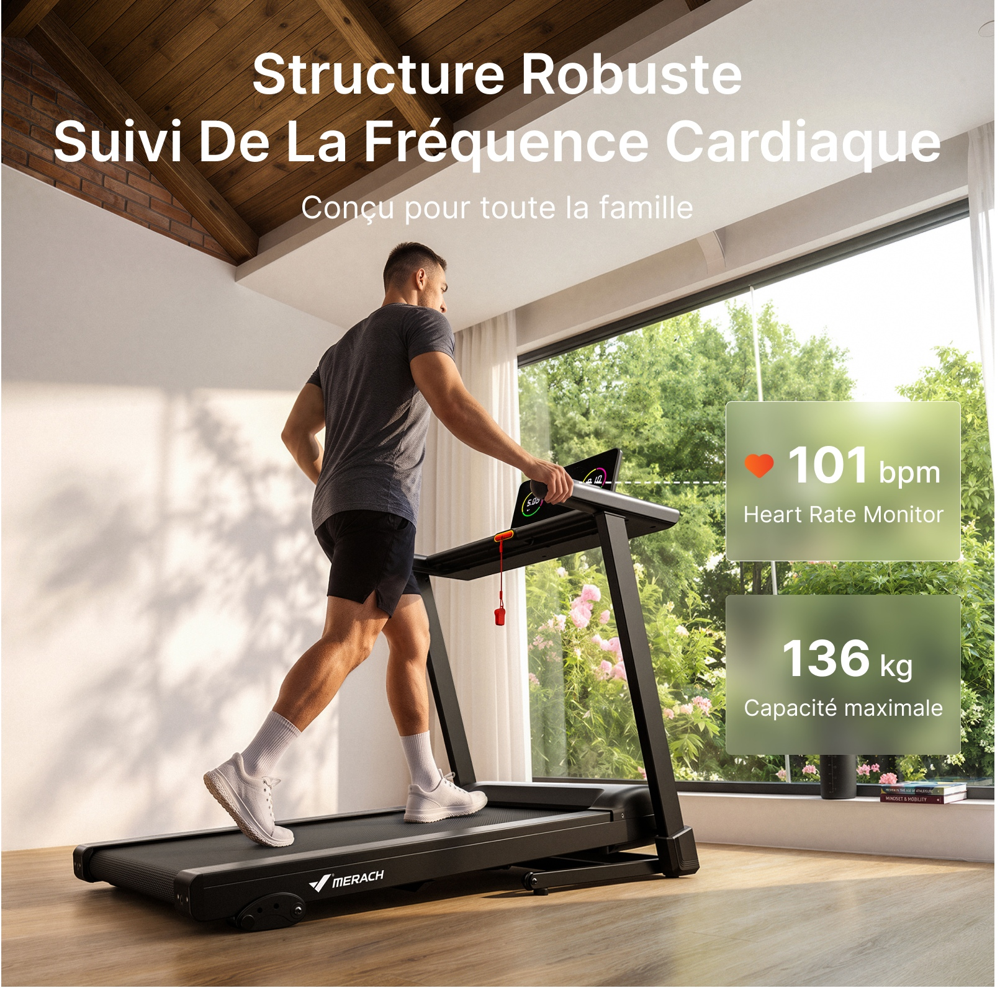

# PP-B05 · 跑步机02.jpg

来源尺寸：9473 × 5731。下方 10 个独立广告模块均逐张放大查看；顶部白底产品主图只浏览概览。

观察限定：字族未经识别，字号与版面比例为目视关系；广告参数及功效未核验。每条方法使用时须重新绑定目标产品事实和用户固定文案。

[随包原始拼板](../../assets/cases/pp-20261021/originals/board-05.jpg)

| 案例 | 主题 | 卖点检索 |
|---|---|---|
| PP-B05-C01 | 深灰技术近景中的同轴分解电机 | 电机结构、动力、速度范围、噪声 |
| PP-B05-C02 | 主结构特写加三个坡度状态卡 | 手动坡度、多档调节、训练选择 |
| PP-B05-C03 | 三种步态并列说明多样训练 | 多样训练、走与跑、家庭使用场景、程序选择 |
| PP-B05-C04 | 双层证据：跑带材料分层与缓冲点定位 | 减震、缓冲、多层材料、防滑 |
| PP-B05-C05 | 三类产品居中突出与逐行属性比较 | 产品定位、适合家居、功能组合、选型比较 |
| PP-B05-C06 | 同一客厅中的展开折叠对照与透视尺寸线 | 折叠收纳、尺寸、液压折叠、移动轮 |
| PP-B05-C07 | 真实控制台周围展开应用界面矩阵 | 应用连接、数据记录、训练内容、课程与地图 |
| PP-B05-C08 | 白色表面尺寸箭头加独立纹理样本 | 跑带尺寸、表面纹理、运动空间 |
| PP-B05-C09 | 斜俯视操作场景与折角虚线定位 | 扶手控制、速度调节、按钮便捷 |
| PP-B05-C10 | 真实握持动作加毛玻璃数据卡 | 心率显示、承重参数、家庭使用 |

## PP-B05-C01 · 深灰技术近景中的同轴分解电机

原图像素区域：[2072, 1983, 3683, 3582]。查看深度：overview_and_individual_module_crop_inspected。

**文字排版**：深灰背景上白色粗体两行大标题，白色较小副标题居中；底部三组参数横向等距，蓝色数字最醒目，白色单位小一档，解释再小一档并左对齐各自数值。

**图片布局**：上半部留标题，中部一个横向电机分解组件占满宽度，下半部用真实黑色纹理跑带承接三列数据。电机部件沿同一水平轴排列，中央间距扩大以展示内部。

**卖点表达与可见证据**：分解后的机械外形让“驱动核心”可被看见，但无刷、电机功率、速度范围与噪声都是文字声称；仅凭渲染机械图不能验证。

**光效与标注**：金属部件采用亮边与暗面形成体积；蓝色和橙色窄亮带分别沿几个圆柱组件的周向环绕，呈现短线重复造成的旋转感，全部围绕同一水平轴。不是向房间四散的能量束。

**可迁移提示词片段**：

> 在中性深灰背景中拍摄产品已确认的驱动区域，以真实跑带或外壳纹理作为下方承托。只有有结构图时，沿实际轴线适度展开少量机械部件，保持轴心、尺寸和装配顺序一致；周向短亮线贴着真实旋转件，不穿透实体外壳。上方白色标题解释功能，底部三列只呈现用户提供且互相关联的真实参数，数字用单一强调色，单位与说明用白色小字。缺少结构资料时改为封闭部件特写，不生成假剖面。

**适用边界**：示意图不是无刷结构、噪声或功率的证据。 原图含多语言文案，迁移时需统一目标语言。 三参数必须各有依据，不能填默认功率、速度或分贝值。 橙色光的功能语义需明确，避免暗示过热。

## PP-B05-C02 · 主结构特写加三个坡度状态卡

原图像素区域：[5713, 1983, 7318, 3582]。查看深度：overview_and_individual_module_crop_inspected。

**文字排版**：顶部黑色粗体标题，下一行较小说明；中部左侧放独立大数字与小单位标签；底部每卡左上角黑色档位名、蓝色参数，三个卡片同层对齐。

**图片布局**：上半部是跑台前端与底座侧面大特写，露出上下间隙；左侧空区配刻度与数值。下方三张等大浅色圆角卡使用同人物、同机位、同产品，只通过跑台倾斜程度建立状态差异。

**卖点表达与可见证据**：不同跑台角度与底部支撑关系是坡度变化的线索，三卡让档位数可数清；具体手动方式及各档百分比仍来自文字。

**光效与标注**：图中没有蓝色发光轮廓；蓝色只用于数字。左侧黑色弧形短刻度线和数字是平面说明，没有明确实物旋转中心，不能作为精确测角工具。

**可迁移提示词片段**：

> 先用一张真实侧面近景展示产品可调机构与上下间隙，下方按实际档位数量排列状态卡。每张卡保持同一产品、人物、镜头、地面基线和尺度，只改变用户确认的调节状态；卡左上角放状态名和已确认参数。若用刻度，必须有明确测量口径与真实支点；缺少角度资料时用简洁档位标签代替刻度。数字采用统一强调色，背景与卡片低对比，结构本体保持清晰。

**适用边界**：不把三档模板强加给只有两档或连续调节产品。 坡度百分比不能直接作为角度刻度。 原图的侧面状态差异较小，生成时需要保留真实变化，不能夸张。 不把静态档位图写成自动电动升降。

## PP-B05-C03 · 三种步态并列说明多样训练

原图像素区域：[7519, 1983, 9130, 3582]。查看深度：overview_and_individual_module_crop_inspected。

**文字排版**：上方居中黑色粗体两行标题，数字与标题同属主层；下方居中较小副标题。整张图没有额外参数小卡，文字密度低，步态成为主要信息。

**图片布局**：三台同型产品从左后到右前横向排开，三名成年使用者分别呈步行、慢跑和更大步幅跑步姿态，朝向一致。左右边缘裁切部分器械和腿部，中心人物最完整，留白集中于上方。

**卖点表达与可见证据**：可见的是不同步幅、手臂摆动和身体前倾程度，支持多种使用情境的理解；“内置若干程序”的具体数量没有在画面中逐项展示或验证。人物年龄与体型不能证明医学适用范围。

**光效与标注**：无功能光效。柔和侧光与地面斜向窗影统一三组主体，人物和设备有真实接触阴影；画面借动作差异而非速度拖影表达训练强弱。

**可迁移提示词片段**：

> 在同一中性空间中以统一侧面角度呈现目标产品的多个已支持使用状态，人物分别展示自然步行、慢跑或用户指定动作，方向一致、接触点真实、每个人只对应一台器械。用步幅、手臂摆动和身体姿态区分状态，不用夸张残影。上方保留两行以内的标题和一句解释；若要讲程序数量，必须有真实程序资料或界面证据，不能仅凭三名人物推导数量。

**适用边界**：三种动作不能证明程序数量。 不根据人物年龄、肤色或体型推导适用人群或健康收益。 多人物多设备对生图工具更复杂，输入身份和设备对应应逐一明确。 原图裁切会影响局部动作完整性，迁移可改为较宽画幅保证脚与跑带关系可见。

## PP-B05-C04 · 双层证据：跑带材料分层与缓冲点定位

原图像素区域：[243, 3801, 1841, 5394]。查看深度：overview_and_individual_module_crop_inspected。

**文字排版**：顶部黑色粗体两行标题及较小副标题。两张横向卡的左侧分别为大号蓝色数量、黑色粗体功能名、灰黑小字说明，层级一致；数字比卡内标题明显大，方便快速比较。

**图片布局**：上下一大一小接近等高的白色圆角卡，文字左、图右。上卡将柔性跑带按层分离，右上方层叠斜向延伸；下卡展示整段跑台的三分之二俯视，左右边缘的缓冲位置成对出现。

**卖点表达与可见证据**：分层与离散缓冲位置让“面材料”和“支撑件”两种作用路径可区分；层数、缓冲块数量、材料类型及减震性能仍需要产品资料。原图的透明泡状层属于渲染示意，不能视为实物材料照片。

**光效与标注**：上卡只把其中一个中间层处理成半透明青蓝发光质感，叠层边缘随透视变化；下卡蓝光附着在左右侧的若干短方块位置，方块近大远小，光晕窄，中央跑带保持黑色。不是整体表面通体发蓝。

**可迁移提示词片段**：

> 把本图拆成上下两张证据卡：上卡展示已知材料层次，下卡标出真实缓冲部件位置。文字统一放左，图放右。只有已提供材料结构时才将各层沿法线小距离分开，保持实际层序、厚薄关系和材质；用一层低强度半透明蓝色强调所述功能层。下卡从真实俯视角标出确认存在的缓冲点，亮块严格贴合实际位置、数量和透视，光晕不覆盖跑带或人物接触区。未知结构时改用实拍细节和简洁引线，不编造分层或数量。

**适用边界**：不能照搬层数、缓冲块数量或泡状内部材料。 减震与防滑是不同机制，视觉和文案应分别对应。 内部结构图需以目标产品图纸或已确认资料为依据。 蓝色渲染强调不是减震测试，也不能据此给出健康或关节保护幅度。

## PP-B05-C05 · 三类产品居中突出与逐行属性比较

原图像素区域：[2072, 3801, 3683, 5394]。查看深度：overview_and_individual_module_crop_inspected。

**文字排版**：顶部大黑标题和中号副标题居中；中间主产品名置于蓝色胶囊，左右类别名为黑灰文字。下方逐行属性左对齐，细横线分隔，中心列黑字配蓝色对勾，外侧灰字配灰色叉号。最底部有一行更小的总结文案。

**图片布局**：三列分别用桌下走步、家居训练、大型健身器材场景。中心图片更宽更高、上边更高，主产品占优势；下方三行各有三列属性，建立同一阅读顺序。

**卖点表达与可见证据**：场景可见地表现了收纳形态、扶手存在与空间使用方式；“功能够用”“成本高”“占地大”等结论由文本概括，不能由场景图直接证明。叉号出现在一些本身并非缺陷的类别/属性旁，表达存在混淆。

**光效与标注**：没有特效光。三张照片均采用窗边自然光，蓝色只用于主产品标签和对勾，灰度降低对照项权重。中心更明亮但整体保持同一米灰版面。

**可迁移提示词片段**：

> 当用户提供可比较对象和同口径属性时，做三列选型图：每列一个真实产品场景，中心目标产品略放大，三列属性逐行对齐。用一项属性一行的简短文本解释差异，统一测量口径与语言；突出目标项可用单一强调色，其余项保持清晰可读。对勾和叉号只表达经过核实的支持或不支持，不把产品类别、不同用途或主观偏好标成对错。缺少对照资料时改为同一产品的多场景应用，不生成竞品优劣结论。

**适用边界**：原图文字混合多种语言，不继承。 不照搬对竞品价格、用途、尺寸或功能的概括。 叉号不能代替客观缺失证据；主观适合程度宜用中性描述。 场景尺度不统一可能夸大差异，需控制产品和空间比例。

## PP-B05-C06 · 同一客厅中的展开折叠对照与透视尺寸线

原图像素区域：[3908, 3801, 5518, 5394]。查看深度：overview_and_individual_module_crop_inspected。

**文字排版**：上方黑色粗标题与居中较小副标题。尺寸标注是中等黑字，贴着对应的虚线段，避免与标题竞争。左下细节卡用蓝色大数字引导，其下黑色粗功能名和说明；右卡仅用功能名与说明。

**图片布局**：同一客厅左后方放折叠状态，右前方放展开状态，沙发提供生活尺度。各机身周围有高度、深度、宽度虚线，地面方向线遵循透视；底部两张卡分别展示支撑杆近景和轮轴。

**卖点表达与可见证据**：两种状态的真实几何与占地轮廓直观展示收纳效果；尺寸和折叠时长由标签声称。底部轮轴与杆件能说明部件存在，但省力和受控下降仍需资料。

**光效与标注**：自然窗光来自画面右侧，木地板有反射和实体阴影；无蓝色能量特效。尺寸线是黑色短虚线，起止点为实心圆，线沿外接边界延伸，和折叠杆实物的橙黄色分开。

**可迁移提示词片段**：

> 在同一室内分别呈现目标产品的展开与折叠状态，保持产品比例和真实折叠结构一致，位置错开但不相互遮挡。用细虚线沿各自外接边界标注真实宽、深、高，端点精确落在测量起止处，地面线随透视收敛，竖向线保持竖直。全部尺寸统一单位，明确两组状态标签，必要时注明同一产品的状态示意。下方仅在有对应资料时放液压杆与移动轮实物特写，不写未确认的折叠秒数。

**适用边界**：原图厘米与英寸混排，不应继承；目标图统一单位或完整成对换算。 两个状态不同远近会造成尺寸比较偏差，可加状态标签或改同尺度并列。 不可照搬折叠时长或省力结论。 尺寸线必须指向机身真实外界而非沙发、阴影或地砖。

## PP-B05-C07 · 真实控制台周围展开应用界面矩阵

原图像素区域：[5713, 3801, 7318, 5394]。查看深度：overview_and_individual_module_crop_inspected。

**文字排版**：上方大号黑色标题和中号说明；其下五枚等大图标横排。各界面卡保留自己的短标题、数字和图表层级，整体没有再叠加大段广告字，实体屏幕数码字与应用卡形成主次。

**图片布局**：前视控制台占下半部，中央屏幕与固定在支架上的平板是真实锚点；上方三卡为地图、计划、课程，下方左右两卡为总结与趋势，中间留给屏幕。卡片略有透视旋转但行列关系清楚。

**卖点表达与可见证据**：实体平板、地图/计划/课程卡及图表使应用功能可理解；具体应用兼容性由图标和文案声称，截图本身不足以证明实际连接。右下卡标题为踏频相关指标，与跑步机语境存在潜在错配，不能不加筛选地复用。

**光效与标注**：背景为暖灰渐变，控制台有柔和摄影亮边；界面卡使用白底、细边和轻微投影，不使用全屏蓝色光束。屏幕色彩来自真实UI内容，连接关系由空间组织表达而非虚构网络线。

**可迁移提示词片段**：

> 保留目标产品真实控制台和支架，正面略俯拍，中央设备屏幕显示用户提供的对应应用截图。围绕它排列少量白底界面卡，一卡只表达地图、课程、计划或记录中的一个已确认功能；中央实体屏幕与卡片留有间隔，界面文字清楚且不遮挡操作键。只使用用户已确认兼容的应用名称、图标和真实截图，并核对图表指标与目标产品类别一致。缺少授权或截图时用不含品牌的功能示意卡并明确示意，不伪造真实界面或兼容关系。

**适用边界**：图标存在不等于已经验证兼容；不能自动继承任何应用支持。 原图踏频类指标可能与目标场景不匹配，需逐卡核对。 不能生成看似真实的训练记录、个人成绩或课程授权。 截图细字存在原图分辨率限制，未逐字核验所有UI文本。

## PP-B05-C08 · 白色表面尺寸箭头加独立纹理样本

原图像素区域：[243, 1983, 1841, 3582]。查看深度：overview_and_individual_module_crop_inspected。

**文字排版**：主标题转移到底部浅灰留白区，黑色粗体大字，下一行较小说明。尺寸用白色粗数字与完整单位压在深色跑带上；纵向文字随透视旋转。左侧纹理样本下是两行中号黑字，明显小于主标题。

**图片布局**：后方低机位对准跑带，人物仅保留下半身和抬起鞋底，强化落脚空间；跑带从前景铺向控制台形成纵深。左上空区放一张无引线的黑色纹理样本，底部独立保留标题带。

**卖点表达与可见证据**：跑带真实纹理、脚的尺度和纵横两组尺寸箭头支持空间与材质的理解；菱形表面可以作为可见纹理描述，不能仅凭纹理图证明防滑性能。样本未用引线说明取样位置，迁移时需补足。

**光效与标注**：没有发光尺寸线。白色箭头与数字像平面说明层贴合跑带透视，近端横向箭头向两侧展开，纵向箭头沿左侧边界延伸，随远近缩小和透明度渐变。摄影光凸显鞋底、跑带颗粒和两侧金属条纹。

**可迁移提示词片段**：

> 从目标产品有效运动面的近端低机位拍摄，保留真实纹理和宽长比例，让人物只作为使用尺度，脚自然落在有效范围。采用白色细尺寸线与短箭头，贴合表面透视并分别标出确认的有效宽度与长度，不需要蓝色光晕。左侧留白放一个取自真实表面细节图的纹理窗，用短引线回到取样区域，说明只写可确认材质或纹理。把收益主标题放底部干净色带，避免压住人物与表面证据。

**适用边界**：贴合表面的文字是信息覆盖层，不得生成为真实跑带印刷或改变产品纹理。 纹理外观不能独立证明防滑、耐磨或缓冲等级。 尺寸只能引用用户目标产品数据。 相机透视不能用于擅自扩大运动面积。

## PP-B05-C09 · 斜俯视操作场景与折角虚线定位

原图像素区域：[3908, 1983, 5518, 3582]。查看深度：overview_and_individual_module_crop_inspected。

**文字排版**：上方两行黑色粗体标题与较小居中副标题，文本区域覆盖浅墙并延伸到窗外绿景；左侧单个白底放大窗下方两行说明，字号小于副标题，靠近图而非远离产品。

**图片布局**：人物从背侧高位角度被拍摄，设备和人物沿左下到右上的对角线展开。左侧墙面留一张按钮近景，从说明下方向下再向右折转的黑色虚线，终点落在左扶手按钮附近。

**卖点表达与可见证据**：放大窗中的加减按钮、左手扶住的真实位置及引线明确了部件；但右手正在触碰中央面板，与标题强调扶手操控并不完全一致。后续应让实际操作动作与本图要说明的位置一致。

**光效与标注**：侧窗自然光在墙面与木地板形成柔和斜向亮区。没有功能光效；折角黑色虚线沿空白墙地面路径走，避免穿越人物主体，承担精确定位而非装饰。

**可迁移提示词片段**：

> 采用使用者背侧的高位斜俯视，露出完整扶手、控制台和实际按钮位置。让人物的一只手明确操作本图要讲的扶手按钮，另一只手自然扶稳，不能同时把注意力引到另一组控件。左侧干净墙面放该按钮真实近景，短功能说明在下，折角细虚线沿留白走到准确按钮中心，避开人体和其他控件。标题放低纹理区域，保持字号清楚，不增加光效。

**适用边界**：原图动作与标题焦点略有错位，不能原样迁移。 引线终点不得停在手腕、扶手空白或邻近传感片上。 加减按钮、心率金属片及其他控件功能需根据目标图确认。 屏幕里的速度、程序和时间是参考内容，不作为新产品运行数据。

## PP-B05-C10 · 真实握持动作加毛玻璃数据卡

原图像素区域：[7519, 3801, 9130, 5394]。查看深度：overview_and_individual_module_crop_inspected。

**文字排版**：上方白色粗体两行标题与一行较小副标题。右侧两张绿色毛玻璃卡中的核心数字很大，单位紧随且较小，下方各一行说明；上卡另加橙红色心形小图标。卡片内白字与模糊暗绿底对比强。

**图片布局**：宽窗家居中，人物和整机占左侧至中部，右侧窗景留给上下数据卡。上卡通过一条白色短水平虚线指向手部/扶手接触区域，下面承重卡无引线。整机落地完整，扶手握持动作可见。

**卖点表达与可见证据**：手握扶手形成心率测量情境，心形图标与单位帮助区分心率数据；图片无法确认实际传感方式、测量精度或读数真实。承重值为静态产品规格，人物体型并不能证明该数值。

**光效与标注**：窗外阳光与室内暖反射形成摄影氛围。数据卡只是把其背后绿色植物模糊并降低对比度，带细白边和圆角，不是绿色能量团；上卡短虚线从接触位置向右延伸，线不跨越人物躯干。

**可迁移提示词片段**：

> 在自然光家居场景中展示人物与目标产品的真实接触动作。若已确认通过扶手采集心率，人物手掌需正确覆盖实际传感区；若实际来自穿戴设备，则对应展示真实连接来源。右侧空白放低透明度、背景模糊的数据卡，白色功能名与单位清楚，短引线准确连接信号来源。动态读数仅使用用户提供的真实值或明确标注为示意；承重等静态规格独立成另一张卡，只用已确认数据。卡片颜色取自环境并降低饱和度，不能遮挡手、屏幕或产品结构。

**适用边界**：不能仅凭握扶手推断该产品支持心率采集。 不要虚构个人实时心率或把演示数字写成真实测量结果。 承重数值需独立依据，不能从人物体重或外观估计。 “全家适用”不能由单个成年人物使用图证明，亦不应推出医学适用性。
