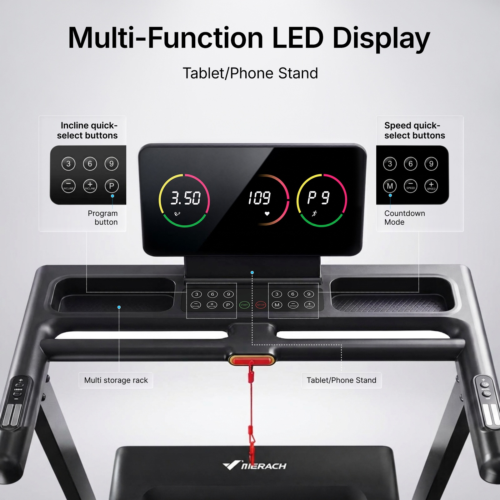
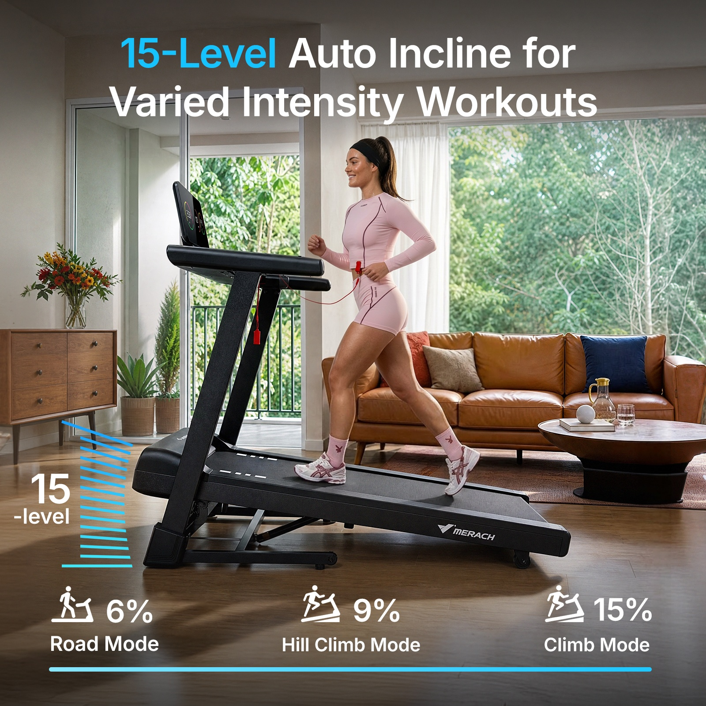
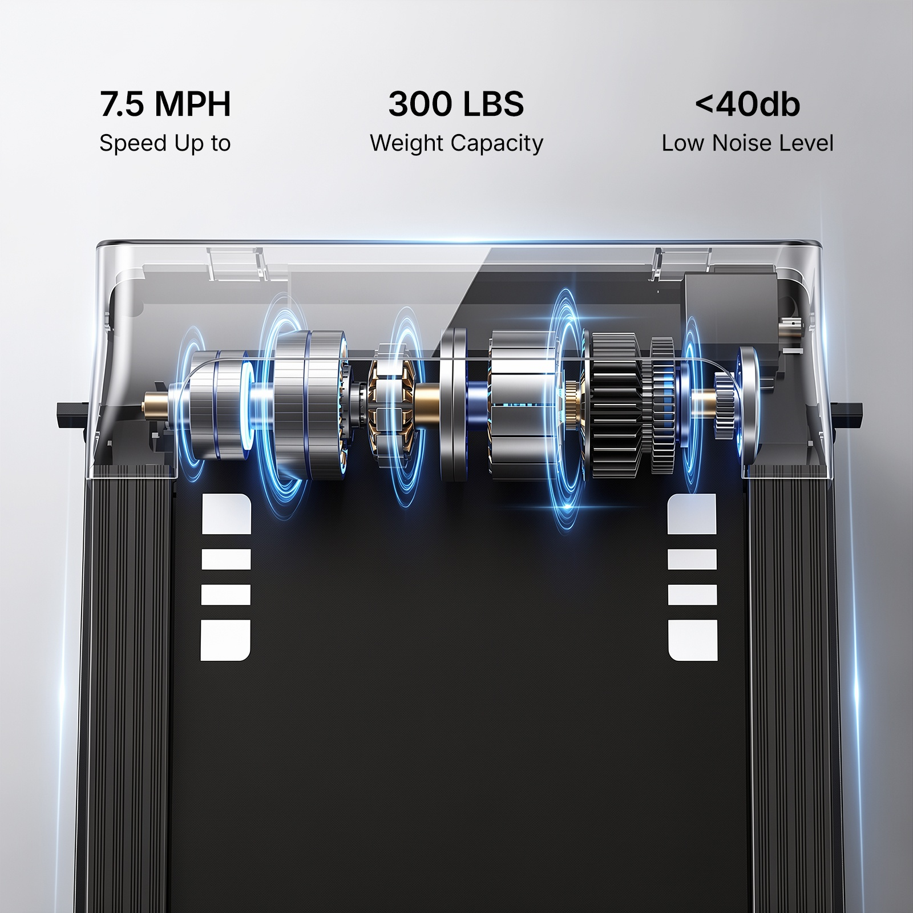
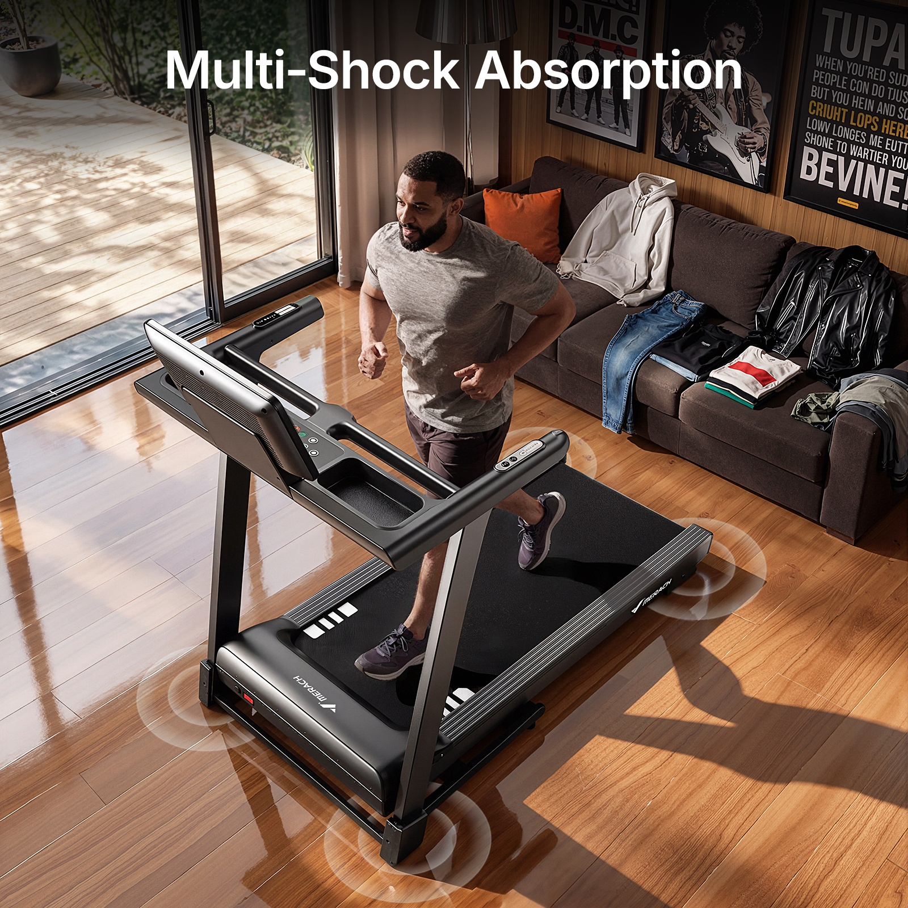
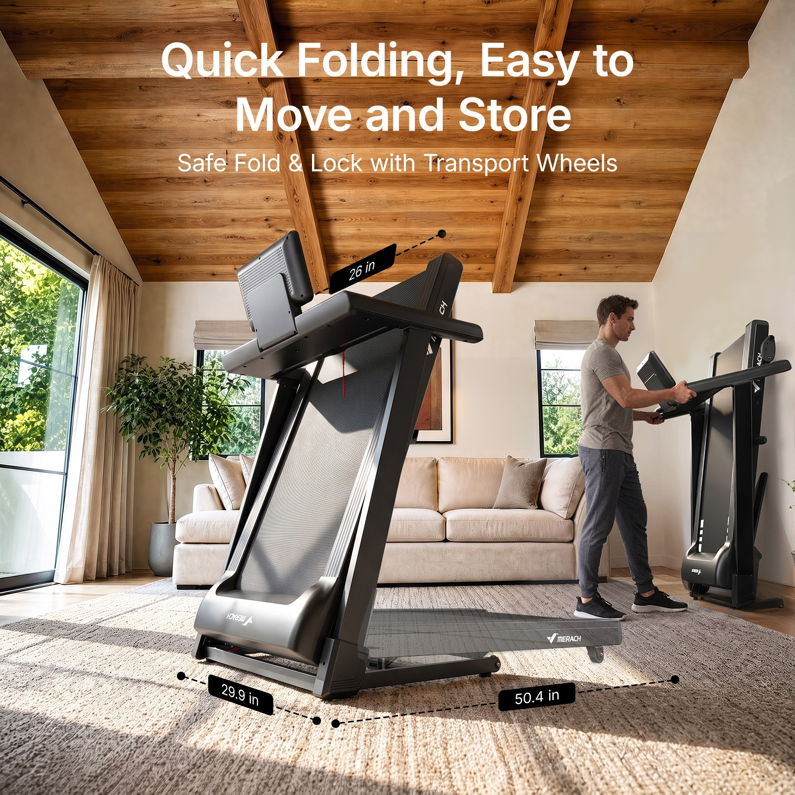
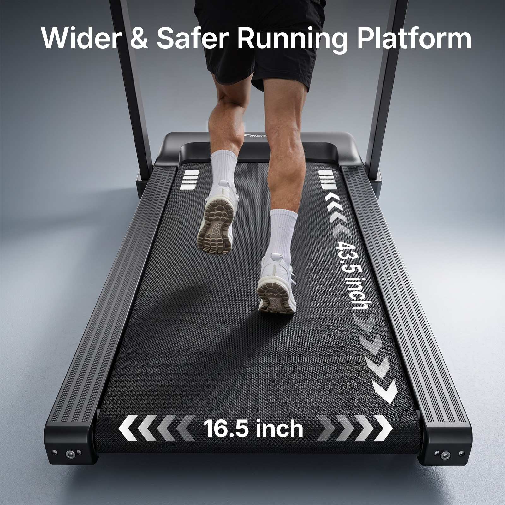
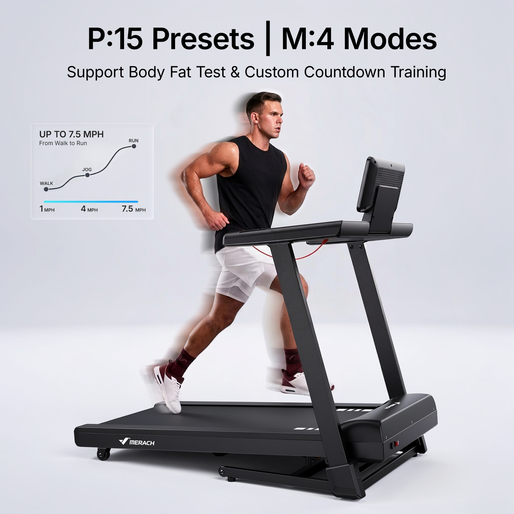
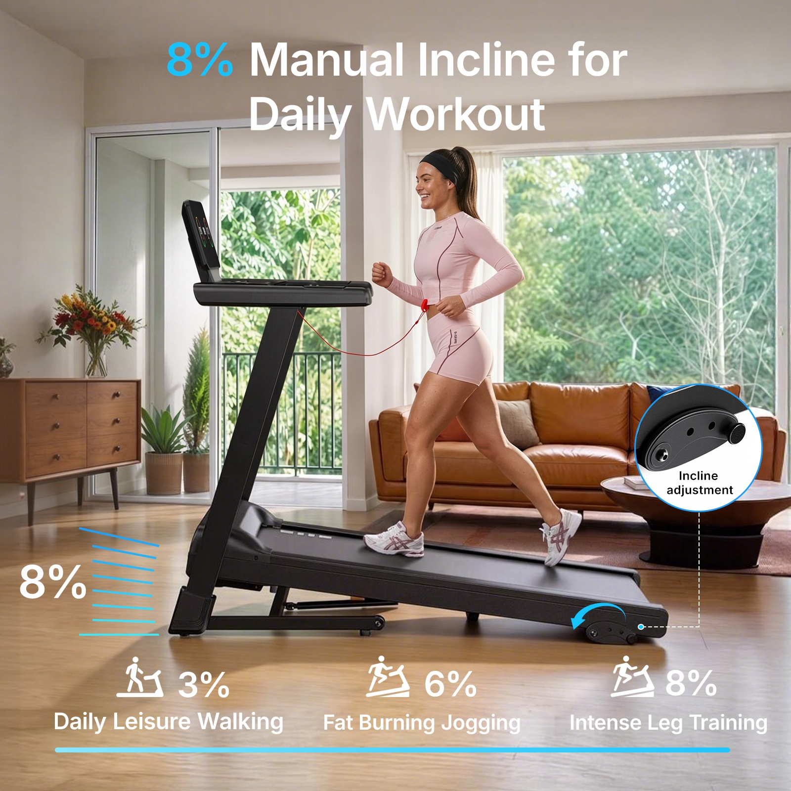

# PP-B06 · 跑步机03.jpg

来源尺寸：8400 × 5000。10 个独立广告模块均逐张放大查看；顶部 2 张白底产品图只浏览概览。

观察限定：字族未经识别，字号与版面比例为目视关系；广告参数及功效未核验。每条方法使用时须重新绑定目标产品事实和用户固定文案。

[随包原始拼板](../../assets/cases/pp-20261021/originals/board-06.jpg)

| 案例 | 主题 | 卖点检索 |
|---|---|---|
| PP-B06-C01 | 控制台正视图：按钮放大窗与逐点引线 | 多功能显示、快捷操作、储物槽、手机平板支架 |
| PP-B06-C02 | 坡度训练：真实抬升状态加阶梯刻度 | 坡度调节、训练强度、多种训练模式 |
| PP-B06-C03 | 动力系统：半透明机罩与同轴分解光环 | 驱动系统、运行性能、噪声参数、承重参数 |
| PP-B06-C04 | 缓震卖点：俯角生活场景中的多个接地点波纹 | 缓震、多点支撑、居家跑步 |
| PP-B06-C05 | 收纳便利：折叠主状态、展开残影与推移场景 | 可折叠、便于移动、节约空间、收纳尺寸 |
| PP-B06-C06 | 跑台空间：低位后视与贴面双向尺寸箭头 | 跑台宽度、跑台长度、活动空间 |
| PP-B06-C07 | 联网训练：真实产品前景与环绕路线界面 | 训练应用、风景路线、排行榜、数据反馈 |
| PP-B06-C08 | 应用连接：真实平板支架与右侧应用图标矩阵 | 应用兼容、课程跟练、平板支架、联网训练 |
| PP-B06-C09 | 多档训练：人物局部运动残影与三阶段曲线 | 预设程序、多种模式、速度调节、步行到跑步 |
| PP-B06-C10 | 手动坡度：机械部件放大窗与围绕转轴的弧箭头 | 手动坡度、机械调节、档位选择 |

## PP-B06-C01 · 控制台正视图：按钮放大窗与逐点引线

原图像素区域：[0, 1700, 1600, 3300]。查看深度：整板总览已看；对应原图坐标裁剪已逐模块查看，展示长边 1100 px，主文案和引线可辨。

**文字排版**：浅灰背景上黑色粗体无衬线主标题居中，副标题约主标题字高的一半；两侧放大窗的功能标题为小号粗体，下方解释为同级常规字重。底部两个白色半透明标签与细线分离，避免文字直接覆盖黑色结构。不能确认具体字体家族。

**图片布局**：控制台占画面中下部约四分之三，中央显示屏正面完整；左右上方分别放大坡度按钮组和速度按钮组，左右视觉重量平衡；扶手和安全绳向下延伸建立真实产品关系。

**卖点表达与可见证据**：按钮组在实物位置被细虚线框圈出，折线连到对应放大窗；储物槽和支架分别以青色小圆点标出锚点。用户可以从放大窗回到真实部件，看到功能实际在哪里。屏幕可见多项读数，但数值仅属于该参考广告。

**光效与标注**：无功能性发光特效。屏幕有宽斜向反射带；彩色弧形读数属于界面图形。青色圆点是信息锚点，白色点状折线避开主体关键区域，再以直角转折连接标签。

**可迁移提示词片段**：

> 用目标产品真实控制台的近正视特写作为画面主体，完整保留屏幕、按钮和支架形状。将本图卖点涉及的两个已知按钮组分别做成左右放大窗；实物位置用细虚线框选，以小圆点和细折线连接各自窗口，线条不交叉。顶部留出居中粗体标题和一行较小副标题；其他已确认部件用短标签逐点说明。放大窗必须来自本次产品附件对应部位，不新增按钮或读数。

**适用边界**：无相应局部产品图时不得凭空补按钮布局；显示读数、快捷挡位、品牌均不能从案例复制。引线证明部位关系，不证明性能。

## PP-B06-C02 · 坡度训练：真实抬升状态加阶梯刻度

原图像素区域：[5100, 1700, 6700, 3300]。查看深度：整板总览已看；单模块放大查看，主标题、坡度结构、刻度与底部模式可辨。

**文字排版**：两行白色粗体无衬线标题置顶，开头的级数关键词用亮青色；底部三列中数字较大、模式名称较小，人物和机器周围留出文字空间。顶部和底部背景略暗，确保白字可读。

**图片布局**：客厅中人物侧向跑步，跑步机从左前到右后横跨画面下半部；抬起的跑台形成清晰斜线。左下窄区放阶梯标记，底部三列图标和模式对齐，青色横线统一收尾。

**卖点表达与可见证据**：跑台前端抬起、后端较低，支撑结构可见，构成坡度的直接视觉证据。旁边多条水平青线按高度堆叠帮助理解可调范围；下方以不同坡度的小图标表达强度层次。

**光效与标注**：主体是来自窗户的自然光和真实地面阴影。阶梯为平面青色信息图形，未画成漂浮能量光；从地面基线向上堆叠，置于机器左侧空白处，不遮脚、跑台或支架。

**可迁移提示词片段**：

> 将目标产品表现为用户已确认的坡度工作状态，以略低的侧前方机位拍摄，让前后高度差和抬升支撑清晰可见；人物双脚与跑带接触合理。产品侧面留出窄区域，使用从地面基线向上排列的细刻度表达调节层次；底部按已确认的档位或使用模式排成等宽三栏，图标、名称和数据一一对应。标题仅将核心卖点词换成统一强调色。

**适用边界**：原图级数和百分比不可迁移；自动和手动调节必须以新产品资料为准。阶梯条数不是测量证据，不应用图形暗示未确认的坡度范围。

## PP-B06-C03 · 动力系统：半透明机罩与同轴分解光环

原图像素区域：[0, 3400, 1600, 5000]。查看深度：整板总览已看；单模块放大查看，部件轴线、半透明罩、光环和参数文字可辨。

**文字排版**：顶部三列黑色参数居中，数值为较大粗体，解释为约其三分之二字号常规体；没有额外长标题。浅灰底让参数与黑色跑带形成上下分区。

**图片布局**：俯看跑台前端，跑带居中下延伸，前罩区域占上中部；机械部件横向分布，读者先看参数，再看结构。左右边框基本对称。

**卖点表达与可见证据**：机罩半透明并展示沿同一轴线排列的机械部件，视觉上解释动力系统位于前端。顶部速度、承重和噪声属于广告数值声称，画面本身没有测试过程，不能从可见结构推出这些性能。

**光效与标注**：细青蓝同心圆环围绕横向转轴分布，圆环在透视下呈竖向椭圆；中心沿部件轴线对齐，局部光点在环缘形成耀斑。机械实体仍遮挡后半环，前半环淡淡叠在金属边缘；外壳边缘用低强度冷白轮廓光保持透明轮廓。

**可迁移提示词片段**：

> 在有目标产品真实内部结构资料的前提下，用半透明外壳展示指定驱动部位，保持各零件真实位置与同轴关系。沿确认的转轴布置少量细青蓝椭圆光环，环面垂直于转轴；后段被实体遮挡，前段半透明可见，亮度低于金属结构高光。顶部以三列数值加短说明呈现用户提供的已确认参数，并注明结构图为示意。

**适用边界**：仅有外观图不能照搬虚构内部结构，应改用真实外部部件特写。光环不证明低噪声、承重或速度；原广告所有数据与内部装配均不可当作目标产品事实。

## PP-B06-C04 · 缓震卖点：俯角生活场景中的多个接地点波纹

原图像素区域：[1700, 3400, 3300, 5000]。查看深度：整板总览已看；单模块放大查看，支点波纹、地面透视和跑步动作可辨。

**文字排版**：顶部单行大号白色粗体无衬线标题，放在背景最暗的一段；没有堆叠副标题或大量参数，画面主要靠产品接地关系表达。

**图片布局**：相机从跑步机左前上方俯拍，机器沿对角线占前景，跑者位于中心，沙发和落地窗交代居家尺度；四周地面足够可见，以容纳多个接地点示意。

**卖点表达与可见证据**：人物正在跑动，机器底部多个角点周围有独立波纹；把抽象的多点缓震声称与底部接地点关联。真实缓震机构没有剖开，静帧无法证明减震量或内部层数。

**光效与标注**：半透明乳白环围绕前后支脚或接地附近展开，在木地板透视下压成椭圆；与地面处于同一平面，中心靠近触点，不围绕人物腰部或整机漂浮。真实窗光形成长阴影，波纹强度低，木纹可穿透。

**可迁移提示词片段**：

> 采用能同时看见人物动作、目标产品底部和周围地面的斜俯视机位。仅在已确认的支撑或缓震接点周围放置低不透明度的短弧形地面波纹，弧线服从地板透视并以接点为中心，后侧被机器遮挡；保持跑带、脚部和支撑结构清晰。顶部留一行简洁标题，将光效作为触点示意使用。

**适用边界**：环形波纹也可能被读成振动增强，若新任务要明确减震，可另加经确认结构的局部放大说明，不能仅靠波纹宣称减震性能。不得生成不存在的缓震层。

## PP-B06-C05 · 收纳便利：折叠主状态、展开残影与推移场景

原图像素区域：[3400, 3400, 5000, 5000]。查看深度：整板总览已看；单模块放大查看，折起实体、展开半透明状态、人物手部和尺寸线可辨。

**文字排版**：顶部两行大号白色粗体主标题，下面一行约半高常规字重副标题；尺寸数值置于黑色斜透视小标签内，白字高对比，标签方向跟随测量轴。

**图片布局**：前景放大折起的跑台，旁边低透明展开跑台保持同一底座；后景右侧的人物推动另一台折起产品。前景解释结构变化，后景解释收纳动作与人体尺度。

**卖点表达与可见证据**：折起跑台与展开半透明跑台共享底部转轴位置，给出状态差；人物双手握扶手、设备靠近墙边，表现可移动的操作方式。三条点状尺寸线标记几何范围，但画面中的具体数值需独立资料支持。

**光效与标注**：无能量光效。主要是半透明展开状态叠加，保持材质与轮廓但降低不透明度，让折叠实体占主导。黑色尺寸虚线沿地面与上部斜边延伸，以实心端点收口，避免误当运动轨迹。

**可迁移提示词片段**：

> 以目标产品的真实折叠状态作为前景主体，仅当提供展开和折起两种结构资料时，在相同底座和转轴上叠加低透明的另一状态，明确标为状态示意。后景安排人物按照真实移动方式握住指定部位，将折叠产品移向收纳位置。使用随空间透视变化的细尺寸线和独立小标签，只填用户提供的对应状态尺寸。

**适用边界**：折叠与展开尺寸不可混标；参考图的多个长度标签不直接继承。无转轴或移动轮资料时不能推断结构，必要时使用独立两栏状态图，避免叠化生成不可能机构。

## PP-B06-C06 · 跑台空间：低位后视与贴面双向尺寸箭头

原图像素区域：[5100, 3400, 6700, 5000]。查看深度：整板总览已看；单模块放大查看，长宽标注、鞋与边缘间距可辨。

**文字排版**：顶部白色粗体单行标题；横向尺寸在跑台近端居中，纵向尺寸沿跑带右侧旋转贴合长轴。数值与箭头同为白色，字体较粗以抵抗深色纹理干扰。

**图片布局**：跑台由近端宽、远端窄的透视梯形占满画面，人物只出现腿和鞋，以小范围遮挡建立尺度；两条标注分别沿前缘宽度和右侧长度分开，不交叉。

**卖点表达与可见证据**：鞋与两侧边缘之间的可见余量帮助理解可用空间；左右双向箭头说明宽度，纵向相反箭头说明长度。安全性是标题声称，画面只直接展示空间与尺寸示意。

**光效与标注**：无发光特效。白到灰的重复人字箭头从数字附近向两端排列，亮度渐变产生方向节奏；箭头随跑台平面透视缩放，人物脚部仍保持实体遮挡关系。

**可迁移提示词片段**：

> 从目标产品后方低机位拍摄其实际使用平面，让近端完整可见、两侧边缘清晰，人物仅保留用于尺度参照的腿部。沿近端横向和一侧纵向分别布置贴合表面透视的双向尺寸标注，数字旁向两端延伸少量重复箭头；箭头不覆盖脚部，也不被误画成产品原有花纹。仅填已确认的可用区域尺寸。

**适用边界**：不要由宽度直接推导更安全或适合所有体型。尺寸属于跑带还是整机须明确；无确认数据时保留空间表达而取消尺寸数值。

## PP-B06-C07 · 联网训练：真实产品前景与环绕路线界面

原图像素区域：[6800, 3400, 8400, 5000]。查看深度：整板总览已看；单模块放大查看，主要界面类别、路线和现实虚拟分层可辨；不逐项核验全部小字。

**文字排版**：顶部灰色弧面区放白色粗体主标题，一行较小副标题；两侧黑色界面卡片内部使用白色字段、黄色曲线和少量青色高亮。主宣传标题与实际界面文字分层。

**图片布局**：跑步机和背向跑者位于中央前景，白色实地与后方环绕城市画面分开；两侧悬浮信息卡让出人物和设备，绿色路线沿城市画面延伸。

**卖点表达与可见证据**：人物面对路线画面，左右的排行和训练曲线同时展示交互收益；城市画面是虚拟训练体验的视觉比喻，不能理解成产品自带巨幅显示屏。参考主副标题中的课程数量属于原广告声称。

**光效与标注**：无明显能量发光。绿色路线是贴在虚拟景观上的宽路径，沿透视收窄并附带头像定位；黑色半透明数据卡叠在景观之上，但保持人物前景不被遮挡。

**可迁移提示词片段**：

> 以用户目标产品和背向运动人物建立真实前景，将已确认应用支持的路线画面作为后方沉浸式场景示意，清楚保留真实设备与虚拟内容的层次。左右各放一个来自用户真实应用资料的信息面板，分别呈现已确认的数据反馈与互动功能；路线沿场景透视延伸，界面不遮人物和产品关键结构。顶部用一行标题加较小副标题解释体验。

**适用边界**：没有真实应用界面时不能伪造第三方兼容、课程量、排行榜或联机功能。应注明沉浸场景为体验示意，不能暗示附赠大屏。

## PP-B06-C08 · 应用连接：真实平板支架与右侧应用图标矩阵

原图像素区域：[1700, 1700, 3300, 3300]。查看深度：整板总览后追加查看单模块，长边 1100 px；主文案、外置平板与原显示层次、四格图标可辨。

**文字排版**：浅灰背景上黑色无衬线粗体主标题居中，下方常规字重副标题约其一半字高；右上四个圆角方形应用标志组成二乘二矩阵，不混入大段说明。屏幕内课程信息为第三层级，小于广告标题。

**图片布局**：控制台从左下斜向右上铺满下方，原显示屏在后，外置平板位于前方真实支架位置；右上保留规整的标志区，使主体和图标互不遮挡。

**卖点表达与可见证据**：平板播放教练课程，屏幕内出现训练数据和应用图标，说明外置设备可承载内容；控制台与平板有明确前后层次。应用兼容性是标志与副标题所做广告声明，图片本身不能验证连接协议。

**光效与标注**：无无线能量光或连线。玻璃上的斜反射与外壳细轮廓高光建立产品质感；彩色弧形为原显示界面内容，应用标志保持原色，不从平板向机器喷射光线。

**可迁移提示词片段**：

> 用目标产品控制台的斜前方近景，完整保留原有显示屏和支架；将用户真实外置平板或手机放在支架上，屏幕展示已确认应用的真实课程界面，清楚区分原机显示与外置设备。右上留白按规整矩阵放置仅限已确认兼容的应用标志。顶部一行利益标题加一行功能副标题，玻璃保留轻微真实反射，界面文字仍可读。

**适用边界**：不能把外置平板误改成机器自带大屏或默认随产品附送；兼容应用标志、课程数量、数据同步能力均须目标产品资料支持，不从案例继承。

## PP-B06-C09 · 多档训练：人物局部运动残影与三阶段曲线

原图像素区域：[3400, 1700, 5000, 3300]。查看深度：整板总览后追加查看单模块，长边 1100 px；曲线节点、主副标题与肢体残影可辨。

**文字排版**：顶部黑色大号粗体主标题，把两个程序数量以竖线分隔；副标题小一半，独立成行。左上小图表内采用粗体速度上限、较小解释、三个节点标签和底部数值，层级不与主标题竞争。

**图片布局**：浅灰背景中完整跑步机占中下部，人物侧向跑步；左侧上方空白放半透明小图表，右侧人物与显示器轮廓清晰。图表和跑步动作形成信息与证据的平衡。

**卖点表达与可见证据**：人物四肢附近低透明运动残影表达动态和速度；曲线以步行、慢跑、跑步三节点示意速度范围。主标题程序数量以及副标题体脂测试、倒计时功能并未由人物动作证明，须另有产品资料。

**光效与标注**：不是发光特效。主人物清晰，头肩、手臂和腿部后侧存在短距模糊重复轮廓；残影沿动作方向拖曳，不让整台产品变模糊。图表为黑色细曲线和青色基线，无能量喷射。

**可迁移提示词片段**：

> 以目标产品完整侧前方和真实运动人物为主，机器边缘、接地点和人物主体保持清晰，仅在正在运动的手臂与腿部后方添加少量低透明短残影，方向与动作一致。画面一侧留白放小型阶段图，使用用户确认的模式或速度节点及对应短标签；图表明确为范围示意，顶部文字逐字使用用户提供的程序和功能信息。

**适用边界**：不能由残影推断具体速度，不能把任意上升曲线当实际训练程序。参考中的速度、程序数量、体脂检测和倒计时能力不可继承；避免重影造成额外肢体。

## PP-B06-C10 · 手动坡度：机械部件放大窗与围绕转轴的弧箭头

原图像素区域：[6800, 1700, 8400, 3300]。查看深度：整板总览后追加查看单模块，长边 1100 px；机械末端、弧箭头、引线与圆形窗口可辨。

**文字排版**：两行白色粗体主标题置顶，坡度数值用青色强调；圆形白底放大窗中有短黑色功能标签。底部三组白色坡度图标、数字和名称对齐，并以一条青色线收束。

**图片布局**：人物和跑步机在客厅侧向使用，机器占画面下半部；右中圆形细节窗靠近空白背景，右下实物部位用折线向上连接；左下阶梯与右侧细节形成两类辅助信息。

**卖点表达与可见证据**：可调节末端支脚的真实形状被单独放大，青色弧箭头围绕该小部件转轴，使手动调节有明确可操作对象；与自动坡度案例相比，新增的是机械操作入口，而不只是数字变化。

**光效与标注**：青色弧箭头从部件上方沿转轴周围弯曲向左下，箭头只包围局部，不围绕整机；实物上小圆点连接白色虚线折线至蓝边放大窗。阶梯为平面青色线，不冒充真实发光结构。

**可迁移提示词片段**：

> 在目标产品已确认的手动调节部位附近设置单个圆形放大窗，窗口取自用户提供的真实细节图，以细折线连接到实物上的对应圆点。若已知转轴与操作方向，用一条短弧箭头绕真实转轴指示动作，箭头置于部件外侧并避开结构孔位。主画面保留实际调节后的使用姿态，底部仅列已确认的档位。

**适用边界**：不能由旧图推断新产品手动转轴或转动方向；调节结构和操作方法需真实图或说明书。原图坡度数值及燃脂名称不得直接继承。
