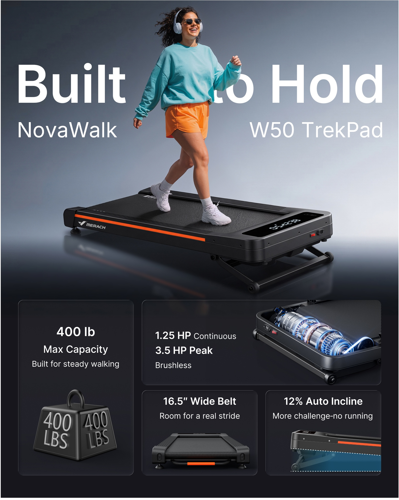
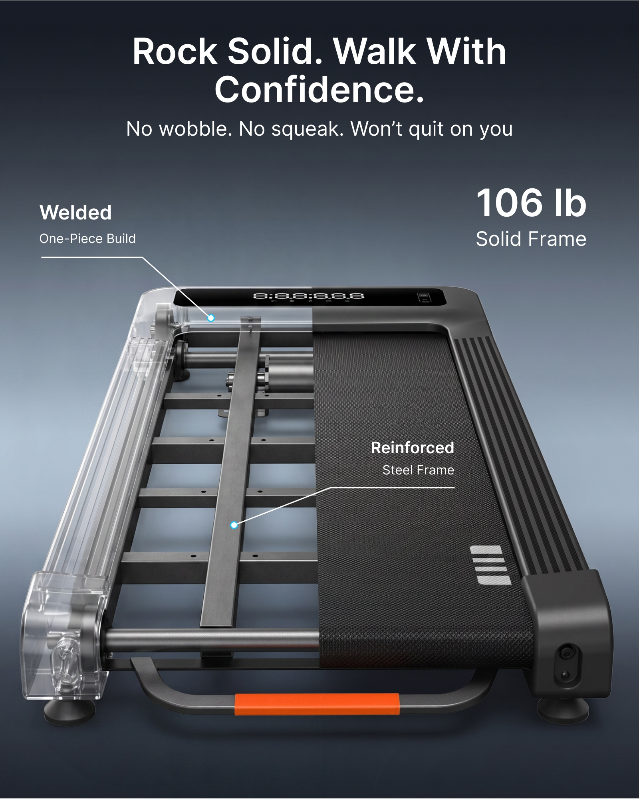
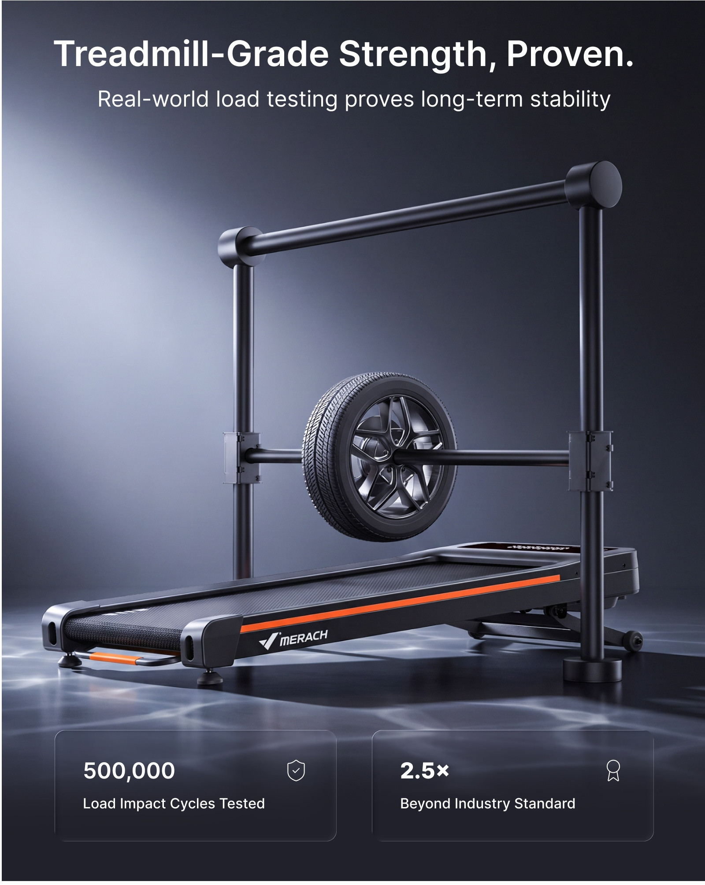
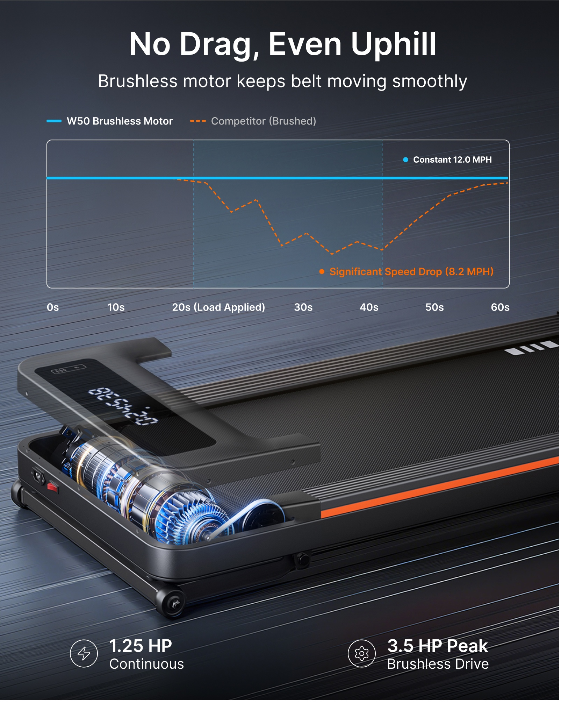
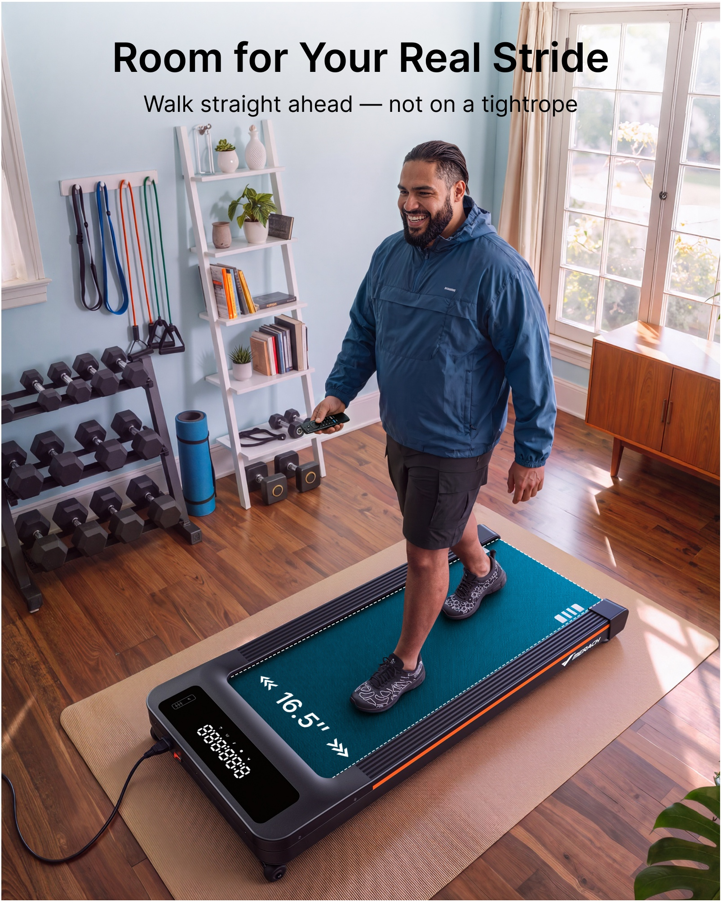
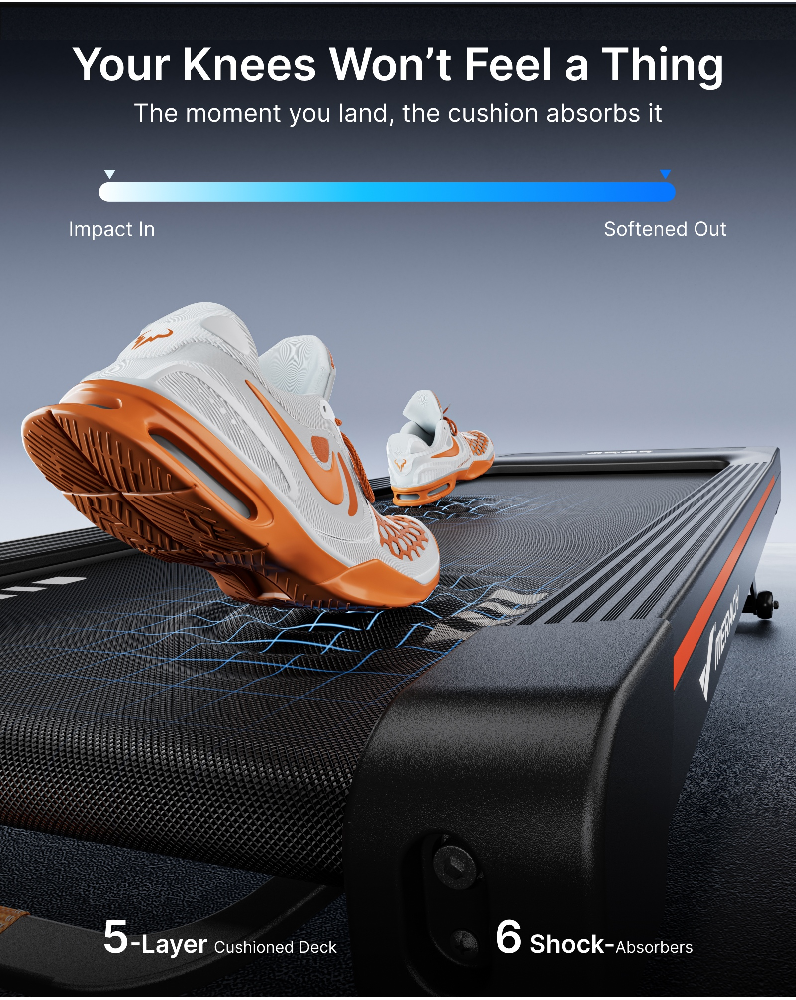
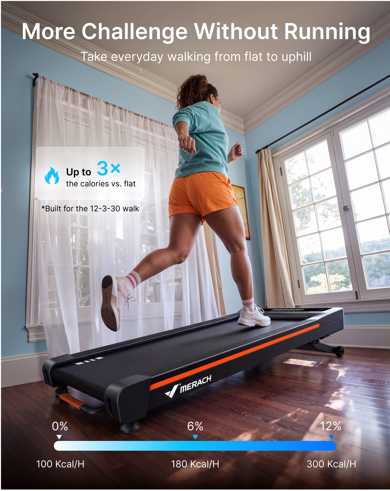
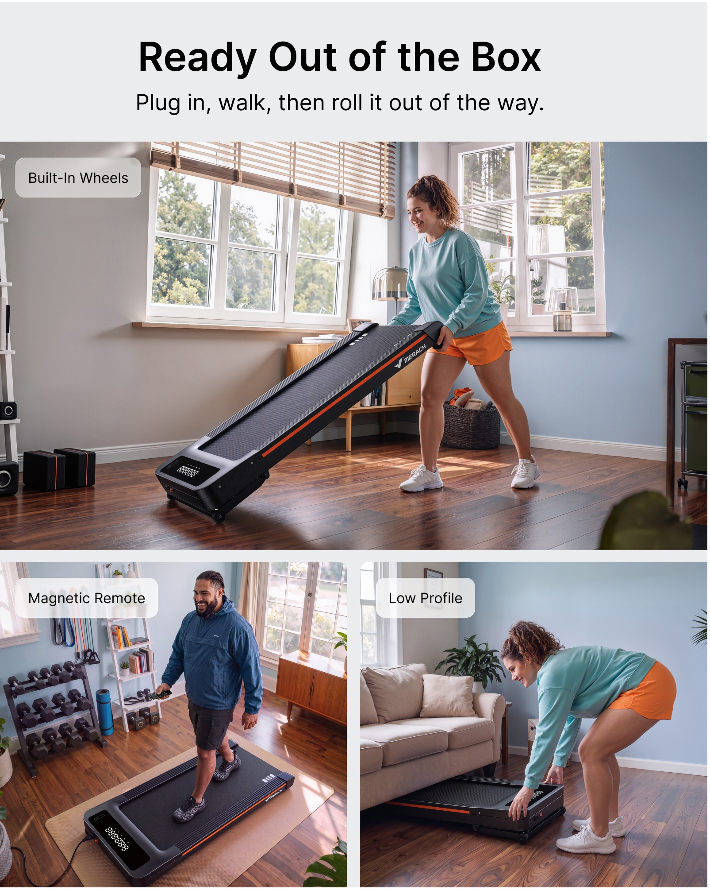

# PP-B07 · 跑步机04.jpg

来源尺寸：7005 × 6164。8 个独立广告模块均逐张查看；顶部白底产品只浏览概览。

观察限定：字族未经识别，字号与版面比例为目视关系；广告参数及功效未核验。每条方法使用时须重新绑定目标产品事实和用户固定文案。

[随包原始拼板](../../assets/cases/pp-20261021/originals/board-07.jpg)

| 案例 | 主题 | 卖点检索 |
|---|---|---|
| PP-B07-C01 | 人物主视觉与多卖点卡片 | 多卖点总览、承重、动力、跑带宽度、坡度 |
| PP-B07-C02 | 局部透壳与钢架引线 | 稳固、结构、钢架、承重结构 |
| PP-B07-C03 | 测试场景与双证据卡 | 耐用、稳定、测试、承重 |
| PP-B07-C04 | 电机局部剖视与曲线分区 | 动力、平稳、电机、性能对比 |
| PP-B07-C05 | 生活动作与跑带透视宽度 | 宽跑带、宽敞、步幅、尺寸、使用空间 |
| PP-B07-C06 | 鞋底触点网格与缓冲过程条 | 减震、缓冲、跑带舒适、接触支撑 |
| PP-B07-C07 | 抬升实景与低位范围条 | 坡度、爬坡、训练强度、调节范围 |
| PP-B07-C08 | 主动作与双辅助生活卡 | 移动、收纳、免安装、遥控、轻松使用 |

## PP-B07-C01 · 人物主视觉与多卖点卡片

原图像素区域：[155, 1885, 1760, 3895]。查看深度：overview_and_individual_crop。

**文字排版**：超大白色无衬线标题横穿上半部，人物遮住少量字形；两侧小一档型号文字。底部卡片内数字与属性加粗，解释句较细。字族无法从图像确定；这是深度层次示例，不意味着固定文案可以被遮到难以辨认。

**图片布局**：上方约六成用于人物和斜向产品，底部约四成分成一个高卡、一条横卡和两个短卡，统一圆角、细边线、暗色底。占比为视觉估计。

**卖点表达与可见证据**：同一主体建立使用体验，四个次模块分别用砝码隐喻、局部电机、正视跑带和侧视抬升状态回答不同问题。

**光效与标注**：柔亮灰蓝背景托起黑色机身，地面有弱反射；电机卡的冷蓝光只在结构附近，橙色为机身原有点缀。

**可迁移提示词片段**：

> 上半部以真实人物使用目标产品建立主视觉，下半部按本图已确认的卖点数量安排大小有别的圆角卡片；主标题在低纹理背景上形成最大字级，固定文字保持完整清晰。每张小卡使用对应产品细节或动作，统一细边框、留白和数字层级。

**适用边界**：不沿用砝码上的承重、马力、宽度、坡度和型号；示意砝码不是实测证据。若文案较长，放独立标题区而非照搬遮字。

## PP-B07-C02 · 局部透壳与钢架引线

原图像素区域：[1855, 1885, 3455, 3895]。查看深度：overview_and_individual_crop。

**文字排版**：顶部两行居中白色粗标题，下方较细副标题；两侧标签左对齐，数字在右上突出；白色短折线末端为青蓝小圆点。

**图片布局**：近正前方俯视产品占中下部，左半局部透壳与右半完整跑带同时出现，让内部和外形对照；标签围绕来源部位分布。

**卖点表达与可见证据**：焊接节点与纵向加固梁被指明，稳固通过具体结构说明。图中文字声称的整机重量不等于承重。

**光效与标注**：透明外壳保留白色高光边，内部银灰梁保持实体材质；青蓝仅用于标注端点，未将整台设备染成霓虹。

**可迁移提示词片段**：

> 以近正前俯视角呈现目标产品，在有结构资料的区域局部降低外壳不透明度，保留完整轮廓和未透视区域；用短折线分别指向确认的连接节点与支撑梁，标签沿两侧留白对齐，端点用小面积强调色。

**适用边界**：只有用户提供内部结构依据时采用透壳；无依据改为已见外部框架与细节放大窗，不虚构钢梁或把自重当承重。

## PP-B07-C03 · 测试场景与双证据卡

原图像素区域：[3548, 1885, 5148, 3895]。查看深度：overview_and_individual_crop。

**文字排版**：居中粗标题与单行细副标题，底部两张并排卡各放一个大数字和一行解释，图标轻量靠边。

**图片布局**：测试架与悬挂轮体围绕跑台形成主画面，底部左右等宽卡承接两项结论，上部标题独立。

**卖点表达与可见证据**：用测试装置和测试结果组织证据叙事；仅凭此宣传图无法证明测试实际完成。

**光效与标注**：左后方冷白柔光刻画测试架和跑台边缘，地面带不规则亮纹和反射，属于环境装饰，不能直接解释为缓冲或耐用数据。

**可迁移提示词片段**：

> 当用户提供真实测试照片及可用结论时，将测试对象和装置置于画面中心，用侧后柔光保持金属边缘清楚；标题置顶，底部用两张同规格卡分开呈现已提供的测试条件和结果，装饰反射低于主体亮度。

**适用边界**：缺少测试依据时不生成仿实验照片、测试次数或行业倍数；改用真实已知结构展示，不能借图像制造认证证据。

## PP-B07-C04 · 电机局部剖视与曲线分区

原图像素区域：[5250, 1885, 6855, 3895]。查看深度：overview_and_individual_crop。

**文字排版**：白色标题、副标题居中；图表图例使用青蓝实线与橙色虚线，图表标注沿对应曲线；底部图标加数字双组。

**图片布局**：上部标题和宽曲线图，下部对角线机身近景，电机位于左前方重点区域；图表与部件空间分离。

**卖点表达与可见证据**：机制与结果成对：局部电机解释动力来源，图表声称负载时的速度变化。原图内各种速度及功率不能作为新产品事实。

**光效与标注**：青蓝窄环沿电机轴线分布，局部机罩半透明，金属叶片边缘可见；斜向细线位于背景和地面，产品与文字保持锐利。

**可迁移提示词片段**：

> 将目标产品已确认的动力部件安排在前景局部窗口，冷色细光环沿真实轴线排列并受外壳遮挡；产品置于下半部斜向构图，上半部为已提供数据或说明预留清楚的图文区，方向线只在背景且不穿过文字。

**适用边界**：无结构资料不做电机剖视；无对比数据不画带坐标的性能曲线，不移植竞品结论，也不凭光环声称磁场实测。

## PP-B07-C05 · 生活动作与跑带透视宽度

原图像素区域：[155, 4045, 1760, 6055]。查看深度：overview_and_individual_crop。

**文字排版**：浅色墙面上的黑色居中粗标题和细副标题；跑带内的白色尺寸数字随平面透视，尺寸两端为向外箭头。

**图片布局**：人物与产品形成由上向下的对角线，跑带完整露出近端宽度；窗边自然生活场景作为背景，标题占顶部低纹理区。

**卖点表达与可见证据**：自然步行站位与可见边缘余量表达宽敞；色块和横向标记强调有效跑步面，而不是靠改变机身比例。

**光效与标注**：青蓝覆盖仅落在跑带有效区域，保留纹理并受鞋底遮挡；两侧白虚线沿纵深收敛。窗光与木地板反射负责真实光影。

**可迁移提示词片段**：

> 从前侧略俯视拍摄人物自然步行，展示目标产品有效使用面和双脚两侧余量；在使用面叠加低透明度强调色，保留纹理与鞋底接触阴影，边界标记贴合真实透视。只有已提供尺寸时，在正确的宽度方向布置尺寸线与原文数字。

**适用边界**：不把跑带染色当作产品真实配色；宽度和长度不能混标，不移植原图数值，不为显宽而拉伸产品。

## PP-B07-C06 · 鞋底触点网格与缓冲过程条

原图像素区域：[1855, 4045, 3455, 6055]。查看深度：overview_and_individual_crop。

**文字排版**：上方白色粗标题与细副标题，下设无坐标的横向白到蓝渐变过程条；底部两个结构参数组以数字较大、说明较小呈现。

**图片布局**：低机位沿跑带方向拍摄，近处鞋底占左前景，另一鞋置后方，跑带向右后收敛；特写动作与图解分区。

**卖点表达与可见证据**：接触点的局部网格形变表达冲击被缓冲的概念；图中的医疗式绝对承诺及结构层数不应直接迁移。

**光效与标注**：稀疏青蓝网格沿跑带透视延伸，在鞋底接触点附近局部起伏后变弱，鞋底自然遮挡网格，保留跑带纹理和阴影；未以光晕覆盖整个人。

**可迁移提示词片段**：

> 以低机位近景呈现鞋底触及目标产品承载面的瞬间，在接触点附近叠加稀疏青蓝细网格，贴合平面透视并向外渐弱，鞋底遮住其下方网格且保持真实接触阴影。上方留独立标题区，若需解释过程使用不带测量刻度的简洁示意条。

**适用边界**：光效为概念示意，不证明疼痛消失、康复或减震率；不得变成整机剧烈扭曲，不复制层数和支点数量。

## PP-B07-C07 · 抬升实景与低位范围条

原图像素区域：[3548, 4045, 5148, 6055]。查看深度：overview_and_individual_crop。

**文字排版**：顶部白色居中标题和副标题，左侧磨砂小卡用蓝色大数字突出；底部色条的刻度和值分上下两行对齐。

**图片布局**：低视角从侧后方展示人物向前迈步，跑台沿对角线且前后高度差可见；大窗与浅蓝墙自然分隔文字区。

**卖点表达与可见证据**：实际抬升状态说明爬坡；底部条带组织档位/范围。原广告将坡度与热量并置，其换算无法仅凭画面验证。

**光效与标注**：以窗边暖日光和木地板反射构建生活质感，青蓝用于信息卡和范围条，不把坡面整体变成能量场。

**可迁移提示词片段**：

> 用低机位侧视完整展示已确认的抬升机构和平台坡面，保持人物脚底接触及机器支撑关系；顶部文案避开窗框，辅助信息置于独立淡色卡。需要表示调节范围时，在底部设置与原文相符的简洁范围条，不遮挡真实坡度。

**适用边界**：不能把档位数当坡度百分比或角度；没有实测条件不增加热量或燃脂倍数，画中坡度服从产品真实规格。

## PP-B07-C08 · 主动作与双辅助生活卡

原图像素区域：[5250, 4045, 6855, 6055]。查看深度：overview_and_individual_crop。

**文字排版**：顶部独立浅灰标题带内用黑色粗标题与细副标题；每个照片模块左上角有小型半透明浅色圆角标签。

**图片布局**：一张大的推行场景置中上，下面两张等宽场景呈现控制和低矮收纳；白色间隔清楚分开三个动作。

**卖点表达与可见证据**：轮子与推行动作证明可移动，手中遥控器解释控制，床/沙发底真实空隙与机身高度关系解释收纳；免安装不单靠这些画面证实。

**光效与标注**：自然窗光与接触阴影贯穿三张场景，没有功能发光特效；人物服装和空间色温连接同一套。

**可迁移提示词片段**：

> 采用上大下双卡布局：主画面展示人物握住目标产品真实可抓握位置，以已确认的移动轮推行；下方两格分别展示用户指定的辅助操作与收纳结果。统一场景光线、人物身份与浅色圆角标签，保持机身和家具间的真实尺度及接触阴影。

**适用边界**：未确认的轮子、遥控功能、磁吸方式与免安装结论不补造；收纳空隙不足不能缩小机身强行塞入。
